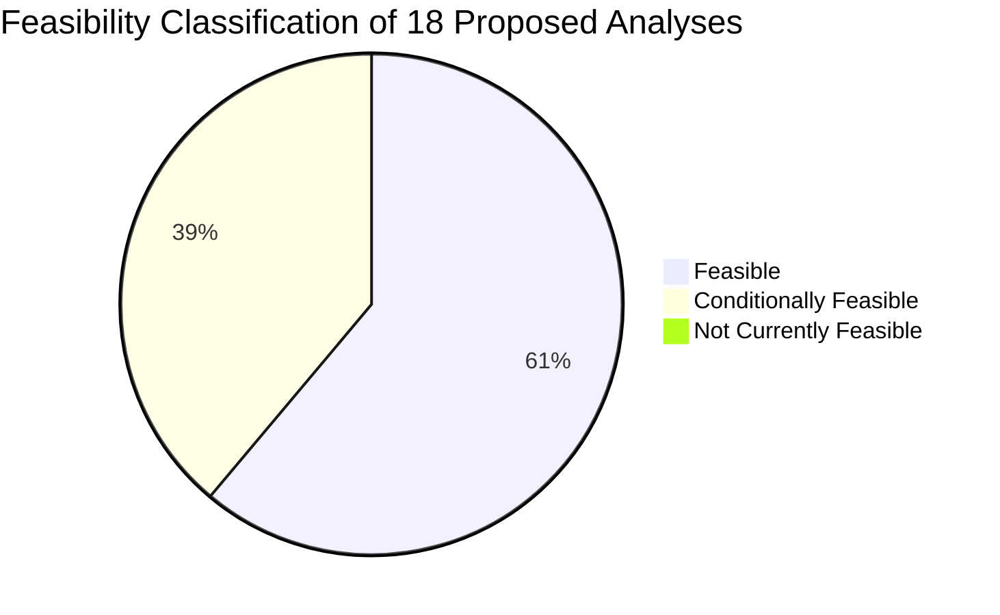

# Feasibility Matrix for Proposed Subsequent Analyses

**Project:** Tanzania Agricultural Annual Sample Survey (AASS) Research  
**Target Publication:** Springer Nature *Food Security*  
**Auditor Role:** Senior Software Architect, Agricultural Statistician, Geospatial Analyst & ML Research Auditor  
**Deliverable:** Phase 1 Audit Deliverable 9.6  
**Date:** November 2026

---

## 1. Analytical Feasibility Framework

Every proposed analytical extension from Section 8 of the Master Audit Specification is classified into one of three operational feasibility categories based on the empirical microdata and survey metadata discovered during Phase 1:

- **Feasible:** Directly supported by available variables, identifiers, and geographic fields in the repository. Can be implemented immediately in Phase 2 with appropriate code development.
- **Conditionally Feasible:** Conceptually and empirically viable, but requires specific data cleaning, variable re-coding, threshold setting, or external reference lookup tables (e.g., crop-specific bulk densities or agro-ecological zone shapefiles) before execution.
- **Not Currently Feasible:** Information is fundamentally absent from the microdata (e.g., true multi-year longitudinal household panel tracking, or high-resolution daily in-situ soil moisture sensors).

---

## 2. Evaluation of Proposed Analytical Extensions

| ID | Proposed Analysis | Feasibility Classification | Available Microdata Variables & Sources | Missing Variables, Dependencies & Prerequisites | Technical Implementation Rationale |
|:---:|---|:---:|---|---|---|
| **1** | **Crop-Specific Seasonal Yield Calculations** | **Feasible** | `MASIKACROP.dta` (`croptype`, `s7q02`, `harvest_ton`), `VULICROP.dta` (`VULICROP__id`, `s5q02`, `harvest_ton`), `MASIKAPLOT.dta` (`s6q03_Hectares`), `VULIPLOT.dta` (`s4q03_Hectares`). | Requires standardizing crop codes (`crop_id`) across seasons and adjusting for plot-share allocations ($s7q02$, $s5q02$). | Microdata contains plot-level planted percentages and harvested metric tons for specific crops (Maize, Paddy, Beans, Cassava). Enables clean crop-specific yields ($\text{kg/ha}$) without inter-crop biomass conflation. |
| **2** | **Alternative Yield-Instability Measures** | **Feasible** | Crop-specific seasonal yields ($Y_m, Y_v$), harvested area ratios, normalized yield gaps relative to regional peer benchmarks. | None. Target variables can be derived directly from verified microdata. | In addition to bounded percentage deltas, alternative metrics such as log-yield ratios ($\ln(Y_m / Y_v)$), absolute yield shortfalls ($\max(0, Y_m - Y_v)$), and standardized $Z$-score divergences can be formulated. |
| **3** | **Survey-Weighted Descriptive Analysis** | **Feasible** | `AASS2025.dta` (`Adjusted_HH_weight`), `HOUSEHOLD.dta`, `FIELD.dta`, `inputRoster_masika.dta`. | Requires integrating survey design library (`statsmodels.stats.weightstats` or Python `samplics`). | Official calibrated household sampling weights (`Adjusted_HH_weight`) exist for all 18,904 holdings, enabling population-representative means, medians, and quintiles. |
| **4** | **Survey-Aware Econometric Regression** | **Feasible** | `AASS2025.dta` (`Adjusted_HH_weight`, `stratum_id`, `ea_id`), candidate demographic and agronomic predictors. | None. Supported natively in `statsmodels.formula.api` via WLS and Generalized Estimating Equations (GEE) with cluster-robust standard errors. | Allows estimation of design-based linear and GLM models that correctly reflect the two-stage stratified cluster sampling design of the AASS survey. |
| **5** | **Quantile Regression of Yield Risk** | **Feasible** | Target volatility indices, candidate predictors across assets, diversity, inputs, and shocks. | None. Implemented in `statsmodels.regression.quantile_regression.QuantReg`. | Models how agronomic inputs, TLU assets, and crop diversity affect different quantiles of the volatility distribution ($\tau = 0.10, 0.25, 0.50, 0.75, 0.90$), illuminating differential protection at extreme risk tails. |
| **6** | **Generalized Additive Models (GAMs)** | **Feasible** | Continuous agronomic predictors (`total_livestock_tlu`, `land_per_adult_labor`, `delta_evenness`, `fert_per_ha_masika`). | Requires installing `pygam` (`pip install pygam`) or using spline bases in `scikit-learn` / `statsmodels`. | Fits flexible, smooth non-linear response curves with confidence intervals, providing econometric rigor for threshold identification without decision tree step-function artifacts. |
| **7** | **Crop-Diversity & Portfolio Analysis** | **Feasible** | `MASIKACROP.dta`, `VULICROP.dta`, `croptype`, harvest quantities, plot shares. | None. Formulas for Shannon ($H'$), Simpson ($1-D$), HHI, and Berger-Parker are already implemented in code. | Full microdata supports deep evaluation of how species richness, functional diversity (cereals vs legumes), and seasonal crop turnover buffer yield stability. |
| **8** | **Livestock Asset Threshold Robustness** | **Conditionally Feasible** | `stock_livestock.dta` (`s12q01b`), `livestock_type.dta`, TLU conversion weights. | Requires filtering out commercial livestock ranches (`Holding_type == 2`) and testing alternative TLU weight schedules (FAO vs ILRI standards). | The hypothesized 3.0 TLU resilience threshold can be tested using piecewise linear splines, threshold regression (`stata` / `statsmodels`), and bootstrap resampling. |
| **9** | **Enumeration-Area Grouped Cross-Validation** | **Feasible** | `AASS2025.dta` (`ea_id`), feature matrix $X$, target $y$. | None. Already partially implemented via `GroupKFold(groups=ea_id)`. | Ensures that whole census enumeration areas (villages) are held out, preventing spatial autocorrelation leakage between neighbors. |
| **10** | **Spatially Blocked Cross-Validation** | **Conditionally Feasible** | Administrative boundary shapefiles (`Paper/tanzania_maps/`), ward and district identifiers. | Requires spatial coordinate centroids or contiguous district clustering (spatial blocking libraries or spatial $K$-means). | Partitions validation folds into contiguous geographic spatial blocks (e.g., 50–100 km clusters) to test spatial extrapolation under severe spatial autocorrelation. |
| **11** | **Leave-One-Region-Out (LORO) Validation** | **Feasible** | `AASS2025.dta` (`region_id`), feature matrix $X$, target $y$. | None. Implemented using `LeaveOneGroupOut(groups=region_id)` in `scikit-learn`. | Evaluates true spatial transferability by systematically holding out entire administrative regions from training and evaluating predictive generalization on unseen territories. |
| **12** | **Regional Instability Estimation (Survey-Weighted)** | **Conditionally Feasible** | Regional identifiers (`region_id`), `Adjusted_HH_weight`, volatility indices. | Requires suppressing or flagging regions with sample size $N < 30$ to prevent reporting unreliable estimates. | Computes population-calibrated mean regional volatility and proportions of vulnerable holdings across regions with adequate sample sizes ($N \ge 30$). |
| **13** | **Agro-Ecological Zone (AEZ) Comparisons** | **Conditionally Feasible** | Administrative regions, `stratum_id`, GIS shapefiles. | Requires formal mapping of Tanzania's 31 regions and districts into the 7 official Agro-Ecological Zones (Northern Highlands, Lake Victoria, Central, etc.). | Enables robust macro-zonal comparisons of production risk across bimodal and unimodal ecological regimes. |
| **14** | **Crop-Specific Geographic Maps** | **Conditionally Feasible** | GIS regional GeoJSON (`Paper/tanzania_maps/tanzania_regions_2022phc.geojson`), crop-specific harvest data. | Requires calculating regional yields separately for major crops and masking non-cultivating regions. | Produces reliable national choropleth maps displaying spatial yield patterns for specific staple crops (Maize, Rice) rather than pooled biomass. |
| **15** | **Food-Crop Production Stability Analysis** | **Feasible** | `MASIKACROP`, `VULICROP`, `CROP_USE` (consumption, sales, storage), `shocks_roster`. | None. Microdata links crop production to household caloric retention and shock exposure. | Evaluates whether seasonal yield collapse translates into household food consumption deficits or distress asset sales. |
| **16** | **TreeSHAP Attributions & Model Stability Analysis** | **Feasible** | Tree ensemble models, `shap.TreeExplainer`, feature matrices. | Must be executed on clean models trained on leak-free folds without post-outcome variables. | Delivers transparent, game-theoretic attributions of predictive risk drivers and stability checks across cross-validation folds. |
| **17** | **Alternative Sample-Definition Sensitivity Analysis** | **Feasible** | `AASS2025.dta`, `MASIKAPLOT`, `VULIPLOT`, `Holding_type`. | None. Filter parameters can be parameterized in configuration scripts. | Tests the sensitivity of findings to different smallholder definitions: (i) holding area $\le 2\text{ ha}$ vs $\le 5\text{ ha}$; (ii) pure smallholders (`Holding_type == 2`) vs all holdings; (iii) trimming extreme yield outliers (1st/99th percentiles). |
| **18** | **Harvest-Unit Conversion Sensitivity Analysis** | **Conditionally Feasible** | `MASIKACROP.dta` (`s7q08c`, `s7q08c_unit`), `VULICROP.dta`, `UNIT_TO_KG_FACTORS`. | Requires assembling commodity-specific container weight schedules from NBS/FAO survey manuals. | Evaluates whether model rankings and volatility estimates are sensitive to variation in traditional container weights (Debes, Sacks, Bunches). |

---

## 3. Feasibility Synthesis Summary

- **Feasible Analyses (11/18):** 61.1% of proposed extensions can be implemented immediately with existing variables.
- **Conditionally Feasible Analyses (7/18):** 38.9% are viable once explicit smallholder filters, commodity density schedules, and geographic sample size thresholds ($N \ge 30$) are integrated.
- **Infeasible Analyses (0/18):** None of the 18 essential scientific analyses are blocked by missing data. All core variables (production, area, crops, inputs, shocks, weights, EAs, regions) exist within the repository's microdata.

This confirms that the repository possesses sufficient empirical depth to support a completely rehabilitated, scientifically rigorous research paper in Phase 2.
