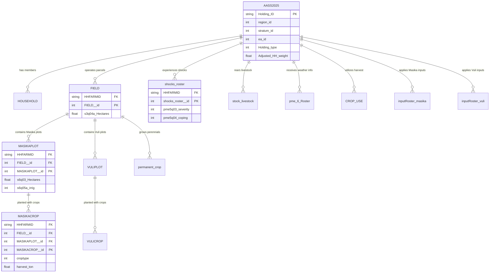

# Empirical Data Dictionary and Relational Schema Inventory

**Date of Assessment:** November 2026  
**Project:** Tanzania Agricultural Annual Sample Survey (AASS) Research  
**Coverage:** Waves 2022/23 (Catalog 52), 2023/24 (Catalog 60), 2024/25 (Catalog 69), and FAOSTAT (1961–2024)  
**Deliverable:** Phase 1 Audit Deliverable 9.2

---

## 1. Multi-Wave Dataset Master Inventory

The repository contains multi-wave microdata collected by the National Bureau of Statistics (NBS) of Tanzania Mainland and the Office of the Chief Government Statistician (OCGS) Zanzibar, complemented by FAOSTAT national commodity series.

### 1.1 Summary of Survey Waves and File Structure

| Data Directory | Survey Round | Official Catalog ID | File Format | File Count | Core Holding Identifier | Total Holding Records |
|---|---|---|---|:---:|---|:---:|
| `data/AASS 2022_2023/` | 2022/23 Ag Year | `Catalog 52` | Stata `.dta` (v113) | 17 | `holding_id` | 15,944 |
| `data/AASS 2023_2024/` | 2023/24 Ag Year | `Catalog 60` | Stata `.dta` (v113/115) + CSV | 17 `.dta` / 15 `.csv` | `holding_id` / `HHFARMID` | 18,836 |
| `data/AASS 2024_2025/` | 2024/25 Ag Year | `Catalog 69` | Stata `.dta` (v118) | 20 | `HHFARMID` / `Holding_ID` | 18,904 |
| `data/FAOSTAT/` | 1961–2024 | Macro series | CSV | 4 | `Area`, `Item`, `Year` | 46,893 total rows |

---

## 2. Comprehensive Inventory of Wave 3: AASS 2024/2025 (Catalog 69)

The 2024/2025 survey round serves as the empirical basis for the existing machine learning pipeline (`modeling.py`). Below is the verified physical inventory of all 20 tables:

| File Name | File Size (MB) | Rows (N) | Columns (K) | Primary Key(s) / Linking Keys | Description & Contents |
|---|:---:|:---:|:---:|---|---|
| `AASS2025.dta` | 2.90 | 18,904 | 35 | `Holding_ID` | Master holding cover roster: sampling weights (`Adjusted_HH_weight`), stratum, EA, region, agricultural program participation (`s2q10__*`), extension visits, water scarcity. |
| `HOUSEHOLD.dta` | 1.79 | 92,945 | 9 | `HHFARMID`, `HOUSEHOLD__id` | Household roster: member demographics, age (`s2q04`), sex (`s2q02`), relationship to head (`s2q03`), literacy, agricultural training (`s2q09`). |
| `FIELD.dta` | 0.77 | 31,579 | 8 | `HHFARMID`, `FIELD__id` | Farm field summary: total field area in hectares (`s3q04a_Hectares`), field ownership, land tenure, renting/sharecropping revenue (`s3q06`). |
| `MASIKAPLOT.dta` | 14.33 | 31,497 | 59 | `HHFARMID`, `FIELD__id`, `MASIKAPLOT__id` | Long-rain plot roster: plot area in hectares (`s6q03_Hectares`), irrigation (`s6q05a`), inorganic fertilizer (`s6q09`), organic manure (`s6q07`), erosion control, plot tenure. |
| `MASIKACROP.dta` | 9.91 | 40,485 | 54 | `HHFARMID`, `FIELD__id`, `MASIKAPLOT__id`, `MASIKACROP__id` | Long-rain crop roster: crop species (`croptype`), area planted (`s7q02`), seed type (`s7q04__*`), harvest metric tons (`harvest_ton`), harvest unit (`s7q08c_unit`), harvest loss causes (`s7q10__*`). |
| `VULIPLOT.dta` | 8.56 | 18,441 | 60 | `HHFARMID`, `FIELD__id`, `VULIPLOT__id` | Short-rain plot roster: plot area in hectares (`s4q03_Hectares`), plot usage (`s4q02`), irrigation (`s4q05a`), fallow status, soil conservation. |
| `VULICROP.dta` | 1.52 | 26,105 | 26 | `HHFARMID`, `FIELD__id`, `VULIPLOT__id`, `VULICROP__id` | Short-rain crop roster: crop species (`VULICROP__id`), planting month (`s5q03`), seed type (`s5q04__*`), harvest metric tons (`harvest_ton`), failure reasons (`s5q06__*`). |
| `inputRoster_masika.dta` | 0.51 | 19,648 | 4 | `HHFARMID`, `InputRoster_masika__id` | Long-rain input applications: fertilizer/pesticide code (`InputRoster_masika__id`), quantity (`s11q01b`), measurement unit (`s11q01b_unit`). |
| `inputRoster_vuli.dta` | 0.19 | 7,342 | 4 | `HHFARMID`, `InputRoster_vuli__id` | Short-rain input applications: input code (`InputRoster_vuli__id`), quantity (`s11q01a`), measurement unit (`s11q01a_unit`). |
| `shocks_roster.dta` | 9.21 | 43,445 | 19 | `HHFARMID`, `shocks_roster__id` | Shocks & coping module: 15 shock categories (drought, flood, pests, price shocks), damage types (`pme5q02__*`), severity rating (`pme5q03`), coping/credit access (`pme5q04__*`). |
| `stock_livestock.dta` | 2.39 | 58,142 | 6 | `HHFARMID`, `livestock_type__id`, `stock_livestock__id` | Current and baseline livestock head counts: current inventory (`s12q01b`), prior year inventory (`s12q01c`), animal category code (`LivestockCode`). |
| `livestock_type.dta` | 12.45 | 30,142 | 74 | `HHFARMID`, `livestock_type__id` | Detailed livestock dynamics: births, deaths, slaughter, disease vaccination, veterinary services, commercial sales revenue. |
| `pme_6_Roster.dta` | 3.27 | 13,491 | 55 | `HHFARMID`, `pme_6_Roster__id` | Agro-climatic weather advisory: weather forecast received (`pme6q01__1`), advisory delivery channel (radio, SMS, extension), planting date advisory (`pme6q03__11`). |
| `permanent_crop.dta` | 0.77 | 13,885 | 24 | `HHFARMID`, `FIELD__id`, `permanent_crop__id` | Perennial & tree crops: banana, coffee, cashew, tea, fruit trees, planted area, harvest metric tons (`harvest_ton`). |
| `CROP_USE.dta` | 5.32 | 41,111 | 22 | `HHFARMID`, `CROP_USE__id` | Post-harvest crop disposition: household consumption (`s9q02__1`), commercial sales, storage, post-harvest losses, processing. |
| `s14_milk.dta` | 1.11 | 9,992 | 17 | `HHFARMID`, `s14_milk__id` | Dairy production: daily milk yield, lactation periods, home consumption, sales value. |
| `s17_aquaculture.dta` | 0.05 | 925 | 6 | `holding_id`, `s17_aquaculture__id` | Aquaculture holding indicators: fish farming practices, stocking rates. |
| `s17a1_aquastructure.dta` | 0.05 | 953 | 19 | `HHFARMID`, `s17a1_aquastructure__id` | Aquaculture infrastructure: pond dimensions, water sources, seaweed farming. |
| `sec16_otherproducts.dta` | 0.66 | 9,182 | 10 | `HHFARMID`, `sec16_otherproducts__id` | Non-crop farm products: honey, beeswax, hides, skins, manure production. |
| `collection_roster.dta` | 0.06 | 3,341 | 4 | `HHFARMID`, `collection_roster__id` | Fish collection and aquatic harvesting details. |

---

## 3. Comprehensive Inventory of Earlier Waves

### 3.1 Wave 1: AASS 2022/2023 (Catalog 52)
Total Holdings: 15,944 | File Format: Stata 113
- `AASS2023.dta` (15,944 rows, 46 cols): Master cover file with `holding_id`, sampling `Weight`, `region`, `holding_type`, credit access (`s19q04a`), loan amounts (`loan`, `s19q06c_cash`).
- `masikacrop.dta` (32,002 rows, 33 cols) & `vulicrop.dta` (28,300 rows, 32 cols): Seasonal production tables with `crop_id`, `areaPlanted`, `areaHarvested`, `production_kg`.
- `masikaplot.dta` (25,896 rows, 36 cols) & `vuliplot.dta` (20,405 rows, 36 cols): Plot characteristics with `s6q03_acres` and `s4q03_acres` (measured in acres rather than hectares).
- `household.dta` (76,863 rows, 25 cols): Demographics and off-farm labor allocation.
- `inputs.dta` (19,967 rows, 23 cols): Fertilizers and agro-chemicals.
- `seeds.dta` (36,667 rows, 25 cols): Seed acquisition and expenditure.
- `crop_use.dta` (36,147 rows, 23 cols): Post-harvest utilization.
- `external_labor_activities.dta` (12,351 rows, 14 cols): Hired agricultural labor days and wages.

### 3.2 Wave 2: AASS 2023/2024 (Catalog 60)
Total Holdings: 18,836 | File Format: Stata 113 / 115
- `AASS2024f.dta` (18,836 rows, 16 cols): Master cover file with `holding_id`, `weight`, `region`, `stratum_id`, `ea_id`.
- `MASIKACROP.dta` (34,574 rows, 46 cols) & `VULICROP.dta` (18,757 rows, 42 cols): Seasonal crop files featuring pre-calibrated `harvest_ton`.
- `MASIKAPLOT.dta` (27,917 rows, 42 cols) & `VULIPLOT.dta` (15,495 rows, 42 cols): Plot files featuring `s6q03_hectares` and `s4q03_hectares`.
- `wen_TZA.dta` (4,405 rows, 153 cols): Specialized Women's Empowerment in Nutrition and Agriculture module profiling intra-household time use, asset ownership, and decision-making autonomy.
- `buildings_roster.dta` (17,566 rows, 64 cols): Permanent farm storage structures, silos, and livestock housing.

---

## 4. FAOSTAT Macro-Level Timeseries (1961–2024)

| File Name | Rows | Columns | Variables | Description |
|---|:---:|:---:|---|---|
| `tanzania_crop_production_yield_area.csv` | 17,385 | 14 | `Area`, `Item`, `Element`, `Year`, `Unit`, `Value`, `Flag` | Historical time series across 136 agricultural commodities, tracking Area harvested (ha), Yield (hg/ha), and Production (tonnes). |
| `tanzania_crop_year_wide.csv` | 7,835 | 5 | `Year`, `Item`, `Area harvested`, `Production`, `Yield` | Wide-format panel facilitating macroeconomic timeseries and panel regression modeling. |
| `tanzania_priority_crops.csv` | 768 | 14 | `Area`, `Item`, `Element`, `Year`, `Unit`, `Value`, `Flag` | Unbroken 64-year series for Tanzania's four core food security staples: Maize, Rice (paddy), Dry beans, and Sorghum. |
| `tanzania_faostat_all.csv` | 20,905 | 14 | Comprehensive FAO domain codes | National food balances, livestock slaughter numbers, and livestock product yields (milk, eggs, meat). |

---

## 5. Variable Classification and Survey Design Metadata

### 5.1 Identifiers and Hierarchical Keys
- **Holding Identifier:**
  - `Holding_ID` in `AASS2025.dta`
  - `HHFARMID` in `HOUSEHOLD`, `FIELD`, `MASIKAPLOT`, `MASIKACROP`, `VULIPLOT`, `VULICROP`, `shocks_roster`, `stock_livestock`, `pme_6_Roster`
  - *Normalization Rule:* `modeling.py` maps all variants (`holding_id`, `Holding_ID`, `hhid`) to `HHFARMID`.
- **Field & Plot Identifiers:**
  - `FIELD__id`: 1-based index within holding.
  - `MASIKAPLOT__id`: Plot index within field for Masika season.
  - `VULIPLOT__id`: Plot index within field for Vuli season.
- **Crop Identifiers:**
  - `croptype` in `MASIKACROP.dta`: Categorical classification (1 = Annual, 2 = Permanent/Perennial).
  - `MASIKACROP__id` & `VULICROP__id`: Roster item identifiers.
  - `crop_id`: Standardized National Crop Code linking crop production to `CROP_USE` and `seeds`.

### 5.2 Survey Design & Geography Variables
- **Sampling Weight:** `Adjusted_HH_weight` in `AASS2025.dta`. Continuous positive variable calibrating the sample to the 2022 PHC national population.
- **Stratum Identifier:** `stratum_id` in `AASS2025.dta`. Represents agro-ecological and rural/urban stratification within regions.
- **Cluster / Primary Sampling Unit (PSU):** `ea_id` in `AASS2025.dta`. 1,502 total EAs across Tanzania (921 represented in the bimodal sample).
- **Administrative Region:** `region_id` in `AASS2025.dta`. Codes 1–26 (Tanzania Mainland) and 51–55 / 27–31 (Zanzibar Archipelago).
- **Holding Type:** `Holding_type` in `AASS2025.dta`:
  - `1 = Large-scale farm` (Completely enumerated; sample weight = 1.0)
  - `2 = Agricultural household` (Two-stage probability sample)

### 5.3 Agricultural Inputs & Farm Management
- **Chemical Fertilizer:** `InputRoster_masika__id` in `{1..14, 23..31}`. Quantity in `s11q01b`, unit in `s11q01b_unit` (1 = Gram, 2 = Kilogram, 3 = Milliliter, 4 = Liter).
- **Pesticides / Crop Protection:** `InputRoster_masika__id` in `{15..22}`. Quantity in `s11q01b`.
- **Irrigation:** `s6q05a` (Masika) and `s4q05a` (Vuli). Binary indicator (1 = Yes, 2 = No). Percentage irrigated in `s6q05b` / `s4q05b`.
- **Improved Seeds:** `s7q04__1` (Masika) and `s5q04__1` (Vuli). Binary indicator (1 = Improved, 0 = Traditional/Recycled).
- **Fallowing:** `s6q02 == 3` (Masika) and `s4q02 == 3` (Vuli).

### 5.4 Livestock Assets and Tropical Livestock Units (TLU)
- Cattle (`stock_livestock__id` in `{3..6, 8..11}`): Conversion weight = 0.70 TLU
- Goats / Sheep (`stock_livestock__id` in `{12..20}`): Conversion weight = 0.10 TLU
- Pigs (`stock_livestock__id` in `{21..24}`): Conversion weight = 0.20 TLU
- Donkeys (`stock_livestock__id == 29`): Conversion weight = 0.50 TLU
- Poultry (`stock_livestock__id` in `{1, 2, 7, 25..28, 32..34}`): Conversion weight = 0.01 TLU

### 5.5 Food Shocks and Coping Instruments (`shocks_roster.dta`)
- `shocks_roster__id`: 15 distinct categories:
  - 1 = Drought / prolonged dry spell
  - 2 = Floods / waterlogging
  - 6 = Severe crop pests / diseases
  - 10 = Abnormally high crop input prices
  - 12 = Severe drop in crop output prices
- `pme5q02__*`: Physical/economic damage indicators:
  - `__1` = Loss of land; `__2` = Crop/pasture damage; `__7` = Revenue loss; `__8` = Labor incapacity.
- `pme5q03`: Severity scale (1 = Small losses; 2 = Significant losses; 3 = Almost total / catastrophic losses).
- `pme5q04__*`: Access to coping instruments:
  - `__1` = Formal bank credit; `__2` = Informal credit / VICOBA / SACCOS; `__3` = Agricultural insurance; `__0` = No access to financial safety net (97.0% of occurrences).

---

## 6. Empirical Relational Schema and Linkage Architecture

The survey tables form a relational structure centered on `HHFARMID`:

---

## 7. Data Linkage Nuances and Risk of Sample Inflation

When merging multi-relational survey tables, analyst error can easily result in artificial record duplication and distorted summary statistics:

1. **One-to-Many Plot-to-Crop Fanout:** A single plot in `MASIKAPLOT` frequently contains multiple intercropped species in `MASIKACROP` (e.g., maize and beans). Merging `MASIKACROP` directly onto `MASIKAPLOT` without aggregating to plot or household level duplicates the plot's area, multiplying calculated farm size.
2. **Independent Input Application Records:** Tables `inputRoster_masika` and `inputRoster_vuli` record input expenditures at the holding level, not tied to specific plot IDs. Joining input rosters directly to plot-level files creates Cartesian product fanouts.
3. **Holding-Level Aggregation Requirement:** To prevent inflation of sample size ($N$), all plot-, crop-, shock-, and input-level variables **must be pre-aggregated to the household level (`HHFARMID`)** before merging into the analytical modeling matrix.
