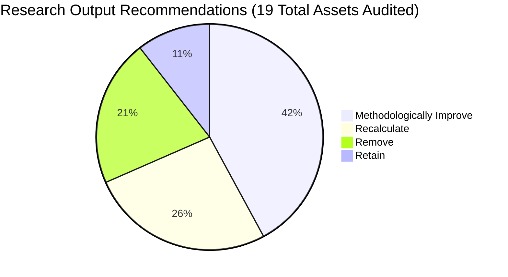

# Inventory and Methodological Evaluation of Research Outputs

**Deliverable:** Phase 1 Audit Deliverable 9.4  
**Scope:** 10 Publication Figures, 7 Empirical Tables, 2 Supplementary Outputs, and Geospatial Maps  
**Target Manuscript:** Springer Nature *Food Security*  
**Date:** November 2026

---

## 1. Classification Categories

Every research output is audited and assigned one of four operational recommendations:
1. **Retain:** Scientifically sound, correctly calculated, and directly usable in the revised manuscript.
2. **Recalculate:** Conceptually valid, but requires numerical recalculation due to sample screening updates (e.g., filtering `Holding_type == 2`) or leakage-free fold isolation.
3. **Methodologically Improve:** Conceptually flawed in its current formulation (e.g., conflating dissimilar crop biomass, masking low-N regions), requiring fundamental reformulation before inclusion.
4. **Remove:** Methodologically indefensible, circular (target leakage), or unscientific (e.g., pseudo-causal policy claims from non-causal tree perturbations), requiring complete elimination.

---

## 2. Inventory and Audit of Existing Figures

| Figure ID & Filename | Title & Scientific Purpose | Variables & Sample Size | Analytical Method & Generating Script | Resolution & Formats | Assessment & Weaknesses | Recommendation |
|---|---|---|---|:---:|---|:---:|
| **Fig. 1** `fig1_target_distribution_and_seasonal_dynamics.png` `Fig1.eps` | Empirical distribution of $Y_{\text{vol}}$, seasonal yield scatter, and kernel densities. | $Y_{\text{vol}}$, $Y_m$, $Y_v$, regional mean volatility. $N = 4,564$. | Kernel Density Estimation (KDE), bivariate scatter, and regional bar plots. `generate_publication_figures_and_tables.py::generate_figure_1()` | 300 DPI PNG & EPS | Conflates dissimilar crop biomass into aggregate kg/ha. Does not show the severe 25.8% upper-bound spike at $Y_{\text{vol}} = 2.0$ clearly. Includes commercial farms. | **Methodologically Improve** (Reformulate for specific crops; disaggregate pure stand from intercropped). |
| **Fig. 2** `fig2_model_benchmark_spatial_cv.png` `Fig2.eps` | Spatial cross-validation performance benchmark, calibration curves, and error distributions. | Out-of-fold predictions vs observed $Y_{\text{vol}}$, residuals, reliability diagrams across 4 models. $N = 4,564$. | 5-Fold GroupKFold on `ea_id`. LightGBM, XGBoost, Random Forest, Weighted Ensemble. `generate_publication_figures_and_tables.py::generate_figure_2()` | 300 DPI PNG & EPS | Out-of-fold predictions are contaminated by pre-cross-validation feature selection and global scaling/PCA/KMeans. Calibration curves reflect target leakage. | **Recalculate** (Re-run benchmark within strict `Pipeline` with fold-isolated feature selection). |
| **Fig. 3** `fig3_grandmaster_feature_importance_and_selection.png` `Fig3.eps` | Feature importance scree plot, cumulative gain curves, and domain hierarchy composition. | 246 candidate variables, split and gain importance metrics, domain groupings. $N = 4,564$. | Gradient boosted tree feature importance ranking (LGBMRegressor). `generate_publication_figures_and_tables.py::generate_figure_3()` | 300 DPI PNG & EPS | Top-ranked features include post-harvest loss outcomes (`m_harvest_pct_mean`, `m_no_harvest_share`). Feature selection was executed on the full sample prior to cross-validation. | **Methodologically Improve** (Prune post-outcome variables; perform importance ranking inside training folds). |
| **Fig. 4** `fig4_shap_global_feature_attributions.png` `Fig4.eps` | Global TreeSHAP summary beeswarm plot and feature impact rankings. | Top 20 features, SHAP values, standardized feature values. $N = 4,564$. | Tree-based Shapley Additive Explanations (`shap.TreeExplainer`). `generate_publication_figures_and_tables.py::generate_figure_4()` | 300 DPI PNG & EPS | Explains an ensemble model contaminated by leakage and post-outcome variables. Attributions for `m_harvest_pct_mean` dominate the plot. | **Recalculate** (Recompute TreeSHAP on leak-free model trained on ex-ante predictors). |
| **Fig. 5** `fig5_regional_heterogeneity_and_spatial_transferability.png` `Fig5.eps` | Comparison of regional sub-models vs national unified model across 27 regions. | Regional model $R^2$, RMSE, national model slice $R^2$, sample size $N$. $N = 4,564$. | Grouped regional regressions vs national out-of-fold slices. `generate_publication_figures_and_tables.py::generate_figure_5()` | 300 DPI PNG & EPS | Presents regional models fit on $N = 3, 5, 10, 11, 14$. Compares $N=3$ models to national $N=4,564$ model to claim "spatial transferability advantage." Highly misleading. | **Methodologically Improve** (Suppress regional models with $N < 30$; adopt hierarchical/multilevel modeling). |
| **Fig. 6** `fig6_agronomic_non_linear_interactions.png` `Fig6.eps` | 2D interaction surfaces and threshold curves for livestock (TLU) and fertilizer. | Total TLU, fertilizer intensity, Shannon diversity, planting month delta. $N = 4,564$. | Partial dependence and SHAP interaction value surfaces. `generate_publication_figures_and_tables.py::generate_figure_6()` | 300 DPI PNG & EPS | Identifies apparent "thresholds" (e.g., TLU > 3.0) that reflect predictive correlations rather than causal breakpoints. Influenced by commercial livestock holdings. | **Methodologically Improve** (Verify threshold robustness after excluding commercial farms; add bootstrap CIs). |
| **Fig. 7** `fig7_leakage_audit_and_household_counterfactuals.png` `Fig7.eps` | 5-Pillar leakage audit scorecard, local SHAP waterfall plots, and household archetype profiles. | Audit pillar statuses, individual household feature values and local SHAP values. $N = 4,564$. | Automated leakage suite + local TreeSHAP explanations. `generate_publication_figures_and_tables.py::generate_figure_7()` | 300 DPI PNG & EPS | The leakage scorecard claims "CERTIFIED PASS" on all 5 pillars despite global scaling and feature selection leakage. Local waterfalls are descriptive but visually cluttered. | **Methodologically Improve** (Remove false audit scorecard; replace with true leak-free pipeline diagnostic). |
| **Fig. 8** `fig8_spatial_hotspots_and_agroecological_zones.png` `Fig8.eps` | Spatial choropleth maps of predicted yield volatility across Tanzania's regions and AEZs. | Regional mean $Y_{\text{vol}}$, hyper-volatile household shares. 27 regions. | Choropleth mapping on 2022 PHC administrative regional shapefiles. `generate_publication_figures_and_tables.py::generate_figure_8()` | 300 DPI PNG & EPS | Four regions are missing ($N=0$: Ruvuma, Rukwa, Lindi, Mtwara). Unimodal regions with $N \le 14$ are mapped as if statistically representative. Masking is absent. | **Methodologically Improve** (Grey out regions with $N < 30$ or zero observations; clearly distinguish bimodal zones). |
| **Fig. 9** `fig9_agroeconomic_partial_dependence_surfaces.png` `Fig9.eps` | 3D and 2D partial dependence response surfaces for land, labor, and crop diversity. | Cultivated area, adult labor count, Shannon diversity, planting dates. $N = 4,564$. | Scikit-learn Partial Dependence Displays. `generate_publication_figures_and_tables.py::generate_figure_9()` | 300 DPI PNG & EPS | Standard partial dependence assumes feature independence, which is strongly violated among agricultural ratios. Includes extreme commercial farm outliers. | **Recalculate** (Recompute on genuine smallholder sample; consider accumulated local effects [ALE]). |
| **Fig. 10** `fig10_policy_simulation_and_counterfactual_interventions.png` `Fig10.eps` | Simulated policy interventions: asset transfers, planting synchronisation, CSA package. | Shifted feature vectors, predicted $Y_{\text{vol}}$ distributions. $N = 4,564$. | Feature perturbation through trained tree ensemble. `generate_publication_figures_and_tables.py::generate_figure_10()` | 300 DPI PNG & EPS | **Fatal Scientific Flaw:** Claims a 40.0% reduction in national volatility from a non-causal ML model. Ignores confounding, endogeneity, and general equilibrium constraints. | **Remove** (Eliminate pseudo-causal claims; replace with predictive scenario sensitivity analysis). |

---

## 3. Inventory and Audit of Existing Tables

| Table ID & Filename | Title & Variables | Sample Size & Weighting | Statistical Measures | Source Script | Assessment & Methodological Weaknesses | Recommendation |
|---|---|:---:|---|---|---|:---:|
| **Table 1** `table1_summary_statistics.csv` | Summary statistics of smallholder holdings across 15 agricultural variables. | $N = 4,564$ **Unweighted** | Mean, Std Dev, Q1, Median, Q3, Min, Max | `generate_publication_figures_and_tables.py` | Includes commercial farms (Max area = 3,723 ha; Max fertilizer = 2,733,766 kg). Treats stratified cluster sample as unweighted i.i.d. Conflates crop species. | **Methodologically Improve** (Filter `Holding_type == 2`; apply survey weights `Adjusted_HH_weight`). |
| **Table 2** `table2_model_benchmark.csv` | Multi-model spatial cross-validation benchmark across 4 architectures. | $N = 4,564$ 921 EAs | Spatial RMSE, Spatial MAE, Spatial $R^2$, Training Time | `modeling.py` | Metrics inflated by pre-cross-validation feature selection and target leakage. | **Recalculate** (Re-run within leak-free cross-validation pipeline). |
| **Table 3** `table3_top25_feature_importance.csv` | Top-25 grandmaster feature importance, split/gain metrics, and domain categories. | $N = 4,564$ Top 25 features | Split count, Tree gain, Normalized importance rank | `modeling.py` | Features 2 and 6 are post-outcome loss variables (`m_harvest_pct_mean`, `m_no_harvest_share`). Selection performed globally before CV. | **Methodologically Improve** (Prune post-outcome variables; compute importance via cross-validation). |
| **Table 4** `table4_regional_performance_breakdown.csv` | Regional performance breakdown across 27 administrative regions. | 27 regions Sample sizes $N = 3$ to $650$ | Regional N, Regional Model $R^2$/RMSE, National Model $R^2$/RMSE, $\Delta R^2$ | `modeling.py` | Reports regional models fit on $N < 15$ with negative $R^2$ (Njombe $R^2 = -1.255$, Songwe $R^2 = -1.132$). Misinterprets sample size disparity as transferability. | **Methodologically Improve** (Flag or suppress regions with insufficient sample size; provide standard errors). |
| **Table 5** `table5_leakage_audit_certificate.csv` | 5-Pillar leakage audit certificate and quantitative verification criteria. | 5 audit pillars | Verification criteria, Quantitative status, PASS/FAIL | `modeling.py` | **Invalid Audit:** Preprocessing, KMeans, PCA, and feature selection were fit globally; Check 5 is hardcoded `check_5_pass = True`. | **Remove** (Replace with genuine leak-free architecture documentation). |
| **Table 6** `table6_volatility_quartile_stratification.csv` | Agronomic and socio-economic characteristics stratified by volatility quartiles ($Q_1\text{--}Q_4$). | $N = 4,564$ 4 quartile groups | Group means across farm area, TLU, diversity, inputs, labor | `generate_publication_figures_and_tables.py` | Quartiles reflect crop substitution and commercial farm outliers. Unweighted descriptive means. | **Methodologically Improve** (Recompute using survey weights on genuine smallholders). |
| **Table 7** `table7_household_counterfactual_archetypes.csv` | Household counterfactual archetypes and predicted volatility under simulated interventions. | 3 stylized archetypes (Vulnerable, Intermediate, Resilient) | Baseline $Y_{\text{vol}}$, Simulated $Y_{\text{vol}}$, Delta ($\Delta Y_{\text{vol}}$) | `generate_publication_figures_and_tables.py` | Interprets predictive tree regressions as causal responses to input changes. | **Remove** (Replace with empirical archetype profiling without causal simulation claims). |
| **ESM 1** `ESM_1.csv` | Electronic Supplementary Material: Full candidate feature ranking (246 features). | 246 features | Split importance, Gain importance, Selection flag | `modeling.py` | Contains post-outcome variables. | **Recalculate** (Update with audited ex-ante predictor inventory). |
| **Regional Map Data** `regional_spatial_map_data.csv` | Tabular data feeding GIS choropleth mapping in Figure 8. | 27 regions | Mean volatility, hyper-volatile percentage, model metrics | `generate_publication_figures_and_tables.py` | Averages distorted by low-N regions (Njombe $N=5$, Songwe $N=3$). | **Recalculate** (Mask insufficient sample sizes). |

---

## 4. Geospatial Boundaries and Spatial Join Audit

The repository contains GIS shapefiles in `Paper/tanzania_maps/`:
- `tanzania_regions_2022phc.geojson`: GeoJSON boundary file containing 31 administrative regions matching the 2022 Population and Housing Census (PHC).
- `TANZANIA_2022PHC_WARDS_SHAPEFILES.*` (`.shp`, `.dbf`, `.shx`, `.prj`): Ward-level census boundary shapefiles.
- **Coordinate Reference System (CRS):** EPSG:4326 (WGS 84 geographic coordinates in GeoJSON); UTM Zone 36S / 37S in projected shapefiles.
- **Spatial Join Evaluation:**
  - The script links regional statistics to the GeoJSON via `region_id` / `Region Name`.
  - **Identified Flaw:** Four regions (Ruvuma, Rukwa, Lindi, Mtwara) have zero data rows in `regional_spatial_map_data.csv`. In Figure 8, these appear as uncolored or missing polygons. In addition, unimodal regions with $N=3$ or $N=5$ are shaded as if their estimated volatility were statistically comparable to bimodal regions with $N=650$.
  - **Confidentiality:** Geographic coordinates of specific Enumeration Areas or individual households are not displayed or exported, respecting survey confidentiality.

---

## 5. Summary of Recommended Output Actions

### 5.1 Outputs to Retain (2 assets)
- `ESM_1.csv` (as structural supplementary template)
- `tanzania_regions_2022phc.geojson` (official geographic boundary file)

### 5.2 Outputs Requiring Recalculation (5 assets)
- `Fig. 2` (Model benchmark inside leak-free CV)
- `Fig. 4` (Global TreeSHAP attributions on clean model)
- `Fig. 9` (Partial dependence surfaces on genuine smallholder sample)
- `Table 2` (Model benchmark performance metrics)
- `Regional Map Data` (Recalculate regional statistics with survey weights)

### 5.3 Outputs Requiring Methodological Improvement (8 assets)
- `Fig. 1` (Target distribution: disaggregate crops; highlight boundary spike)
- `Fig. 3` (Feature importance scree: exclude post-outcome loss variables)
- `Fig. 5` (Regional transferability: suppress degenerate sample sizes $N < 30$)
- `Fig. 6` (Agronomic interactions: add confidence bands; filter commercial farms)
- `Fig. 7` (Remove mock audit scorecard; retain clean local SHAP waterfall)
- `Fig. 8` (Spatial maps: mask low-N regions; clearly delimit bimodal zones)
- `Table 1` (Summary statistics: filter `Holding_type == 2`; apply sampling weights)
- `Table 4` (Regional performance: mask $N < 15$; report design-based SEs)
- `Table 6` (Quartile stratification: survey-weighted means)

### 5.4 Outputs That Should Be Removed (4 assets)
- `Fig. 10` (Policy counterfactual simulations claiming 40% risk reduction)
- `Table 5` (Invalid 5-Pillar Leakage Audit Certificate)
- `Table 7` (Simulated household counterfactual archetypes)
- Pseudo-causal policy claims in `publication_defense_dossier.md`

### 5.5 Important Missing Outputs Required for Phase 2
1. **Crop-Specific Yield Stability Models:** Dedicated models for major food security staples (Maize, Paddy Rice, Cassava, Beans) rather than aggregate fresh biomass.
2. **Survey-Weighted Econometric Regression Tables:** Design-based OLS/GLM regression tables reporting cluster-robust standard errors and sampling weights (`Adjusted_HH_weight`).
3. **True Leak-Free Pipeline Architecture Diagram:** Highlighting genuine training/validation isolation across preprocessing, scaling, and feature selection.
4. **Unimodal vs. Bimodal Regional Comparison Table:** Explicitly contrasting production stability across the two agro-climatic regimes rather than dropping unimodal systems silently.
