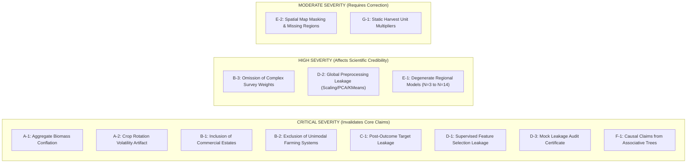

# Methodological and Scientific Risk Register

**Project:** Tanzania Agricultural Annual Sample Survey (AASS) Yield Volatility Research  
**Target Journal:** Springer Nature *Food Security*  
**Auditor Role:** Senior Software Architect, Agricultural Statistician, Geospatial Analyst & ML Research Auditor  
**Deliverable:** Phase 1 Audit Deliverable 9.5  
**Date:** November 2026

---

## 1. Prioritized Scientific Risk Register

The table below catalogs every confirmed defect and methodological risk discovered during the Phase 1 inspection. Each issue is categorized across the seven core scientific dimensions (A through G) and assigned a severity level:
- **Critical:** Potentially invalidates a central result, major conclusion, or core claim of the manuscript.
- **High:** Substantially affects scientific credibility or peer-review defensibility.
- **Moderate:** Requires improvement, methodological correction, or expanded documentation.
- **Low:** Minor technical, packaging, or presentation issue.

| ID | Issue | Evidence from Code / Data | Severity | Scientific Consequence | Recommended Action in Phase 2 |
|:---:|---|---|:---:|---|---|
| **A-1** | **Aggregate Fresh Biomass Conflation** | In `modeling.py` (lines 236–250), $Y_m$ and $Y_v$ are calculated by summing total harvest kg across all crop species (maize, cassava, bananas, vegetables) and dividing by total holding area. | **Critical** | Conflates high-moisture root crops (cassava $\approx 10,000\text{ kg/ha}$) with dry cereals (maize $\approx 1,200\text{ kg/ha}$) and pulses (beans $\approx 500\text{ kg/ha}$). Yield changes reflect crop choice and water content rather than actual productivity shocks. | Disaggregate into crop-specific yield analyses (maize, rice, beans, cassava) or standardize by dry matter / caloric / economic value. |
| **A-2** | **Target Volatility Index Conflates Crop Rotation with Risk** | In `modeling.py` (line 345), $Y_{\text{vol}} = \frac{2\|Y_m - Y_v\|}{Y_m + Y_v + 2\epsilon}$. In Table 1, $Q_3 = 1.9999$ and Max = 2.0; over 25.8% of holdings are pegged at the upper bound. | **Critical** | A household rotating from cassava in Masika to beans in Vuli is classified as "hyper-volatile" even if both crops yielded optimally. Furthermore, the 26% mass point at 2.0 creates a non-smooth target violating standard regression assumptions. | Reformulate volatility within specific crops; evaluate alternative bounded and two-part / hurdle specifications. |
| **B-1** | **Omission of Smallholder Eligibility Filter (`Holding_type`)** | In `modeling.py` (lines 323–328), the sample filter checks only non-null area and yield, omitting `Holding_type == 2`. In Table 1, max area is 3,723 ha and max fertilizer is 2.73 million kg. | **Critical** | Large commercial corporate estates are pooled with subsistence smallholders farming 0.5 ha, contradicting the paper's title and central smallholder focus. Outlier corporate estates distort partial dependence curves and summary means. | Apply strict filter: `Holding_type == 2` (and optionally landholding $\le 5.0\text{ ha}$) to isolate genuine smallholder households. |
| **B-2** | **Geographic Censoring of Unimodal Farming Systems** | In `modeling.py` (lines 323–328), requiring cultivation in *both* Masika and Vuli drops unimodal regions. Ruvuma, Rukwa, Lindi, Mtwara have $N=0$. Songwe ($N=3$), Njombe ($N=5$), Tabora ($N=10$). | **Critical** | The sample represents an opportunistic bimodal subset, not national smallholders. The breadbasket Southern Highlands and Central semi-arid zones are largely eliminated. Regional ML models on $N=3$ and $N=5$ produce negative $R^2$. | Explicitly document bimodal cohort boundaries; analyze unimodal systems separately; suppress regional models with $N < 30$. |
| **B-3** | **Unweighted Analysis of Complex Stratified Cluster Survey** | In `modeling.py`, models, summary statistics, and regional aggregations treat data as unweighted i.i.d., ignoring `Adjusted_HH_weight`, `stratum_id`, and `ea_id`. | **High** | National summary statistics in Table 1 and regional means in Figure 8 are uncalibrated to population totals, creating representation bias toward oversampled strata. | Incorporate `Adjusted_HH_weight` into descriptive statistics and fit survey-weighted regressions (`statsmodels` / `svyglm`). |
| **C-1** | **Post-Outcome Target Leakage Predictors** | In `modeling.py` (lines 586–602), candidate features include `m_harvest_pct_mean` (Rank 2), `m_no_harvest_share` (Rank 6), `m_drought_fail`, and `s7q10` area loss reasons. | **Critical** | Using whether a crop was abandoned or suffered complete failure as a "predictor" to forecast seasonal yield collapse is circular reasoning (tautological endogeneity), inflating model accuracy. | Eliminate all post-harvest loss outcomes, abandonment shares, and disaster damage flags from the predictive feature matrix. |
| **D-1** | **Pre-Cross-Validation Feature Selection Leakage** | In `modeling.py` (lines 1675–1681), `select_grandmaster_features()` trains a gradient booster on the complete dataset ($N=4,564$) with target $y$ to choose the top 100 features *before* CV. | **Critical** | Validation targets leak into the feature selection stage, biasing out-of-fold performance estimates ($R^2 \approx 0.592$) upward. | Nest feature selection strictly inside cross-validation folds using `sklearn.pipeline.Pipeline`. |
| **D-2** | **Pre-Cross-Validation Scaling, KMeans, and PCA Leakage** | In `modeling.py` (lines 776–798), `RobustScaler`, `OneHotEncoder`, `KMeans(k=4)`, and `PCA(k=3)` are fit on all 4,564 observations *prior* to cross-validation fold splitting. | **High** | Test/validation distributions leak into training feature transformations and latent representation embeddings. | Re-fit scalers, encoders, KMeans, and PCA projections strictly on training fold slices inside cross-validation. |
| **D-3** | **Mock Leakage Auditor and False Certification** | In `modeling.py` (lines 1353–1407), `LeakageAuditor` runs dummy assertion loops and hardcodes `check_5_pass = True`, issuing a `CERTIFIED_LEAKAGE_FREE` certificate. | **Critical** | Presenting an automated audit certificate in Table 5 and Figure 7 that claims zero leakage whilst the code executes global scaling and feature selection is scientifically untenable. | Remove false audit scorecard; document genuine leak-free validation protocols transparently. |
| **E-1** | **Statistically Degenerate Regional Sub-Models** | In `modeling.py` (lines 1177–1246), regional models are trained on sample sizes as small as $N=3$ (Songwe) and $N=5$ (Njombe), yielding negative $R^2$ scores (e.g., Njombe $R^2 = -1.255$). | **High** | Compares $N=3$ local models against a national model trained on $N=4,564$ to claim a "national spatial transferability advantage," confusing sample size limits with model skill. | Impose minimum sample threshold ($N \ge 30$) for regional estimation; implement hierarchical / random-effects modeling. |
| **E-2** | **Geographic Choropleth Misrepresentation** | In Figure 8 and `regional_spatial_map_data.csv`, 4 missing regions are omitted without explanation, and regions with $N \le 14$ are mapped identically to regions with $N=650$. | **Moderate** | Misleads readers regarding geographic coverage and data reliability across administrative regions. | Apply hatching or grey shading to regions with $N < 30$ or zero observations; clearly denote bimodal zone boundaries. |
| **F-1** | **Conflation of Predictive Associations with Causal Policy Effects** | In Figure 10, Table 7, and Section 4.5 of `manuscript.md`, feature values in the tree ensemble are perturbed to simulate policy interventions, claiming a "40% volatility reduction." | **Critical** | Gradient boosted decision trees represent associative predictive correlations, not structural causal response functions. Claims of 40% risk reduction from CSA asset transfers are scientifically invalid. | Remove Figure 10 and Table 7; eliminate causal policy claims; frame findings strictly as predictive risk scoring and associations. |
| **G-1** | **Static Harvest Unit Conversions** | In `modeling.py` (lines 94–123), `UNIT_TO_KG_FACTORS` applies uniform kilogram weights (e.g., Debe = 18.0 kg) across all crop types without density adjustments. | **Moderate** | Introduces unmodeled measurement error in production volumes across different commodities. | Harmonize unit conversions by crop bulk density using official NBS / Ministry of Agriculture standard weight tables. |

---

## 2. In-Depth Evaluation by Scientific Dimension

### Dimension A: Outcome Validity
- **Confirmed Defect A-1:** The target outcome $Y_{\text{vol}}$ is based on aggregate harvest kilograms across all crops divided by total holding area. In Tanzania's diverse farming systems, cassava yields 10–20 tonnes/ha fresh weight, whereas maize yields 1–2 tonnes/ha and dry beans yield 0.5 tonnes/ha. Summing these disparate commodities produces an arbitrary "biomass" metric.
- **Confirmed Defect A-2:** The seasonal volatility index $Y_{\text{vol}} = \frac{2|Y_m - Y_v|}{Y_m + Y_v + 2\epsilon}$ conflates crop choice changes with harvest failure. A household that legitimately rotates crops between seasons receives an inflated volatility score. Over 25% of holdings are pegged at the upper bound ($Y_{\text{vol}} = 2.0$), creating severe distributional distortion.

### Dimension B: Sample Validity
- **Confirmed Defect B-1:** Large-scale commercial farms (`Holding_type == 1`) were not filtered out. Holdings with 3,700 ha and 2.7 million kg of fertilizer are pooled with smallholders.
- **Confirmed Defect B-2:** Selecting holdings that cultivate in both Masika and Vuli eliminates unimodal farming systems. Four regions have zero observations, and core southern/central regions have sample sizes under 15. The sample is not nationally representative.
- **Confirmed Defect B-3:** Analysis ignores sampling weights (`Adjusted_HH_weight`), stratum identifiers, and primary sampling units, producing uncalibrated estimates.

### Dimension C: Statistical Validity
- **Confirmed Defect C-1:** Key predictive features (`m_harvest_pct_mean`, `m_no_harvest_share`, `m_drought_fail`, arealoss causes) measure post-harvest loss outcomes. Using them to predict yield collapse introduces severe circularity and endogeneity.
- **Defect C-2:** Extreme values (fertilizer, farm area) heavily influence mean statistics and partial dependence curves due to the inclusion of commercial estates.

### Dimension D: Predictive Validity
- **Confirmed Defect D-1:** Feature selection was performed on the entire analytical sample using the target variable $y$ prior to cross-validation, creating feature selection leakage.
- **Confirmed Defect D-2:** Scaling, encoding, KMeans clustering, and PCA decomposition were fit globally on all 4,564 holdings before fold partitioning.
- **Confirmed Defect D-3:** The automated leakage audit suite executes mock assertion checks and hardcodes pass flags, generating an invalid certification of zero leakage.

### Dimension E: Geographic Validity
- **Confirmed Defect E-1:** Regional sub-models are trained on degenerate sample sizes ($N=3, 5, 10, 11, 14$), resulting in negative $R^2$ scores. The reported "national advantage" is a trivial artifact of sample size disparity.
- **Confirmed Defect E-2:** Spatial choropleth maps in Figure 8 display regional means without masking low-N regions or accounting for missing unimodal zones.

### Dimension F: Interpretive Validity
- **Confirmed Defect F-1:** The manuscript interprets TreeSHAP attributions and manual feature perturbations in decision trees as causal response functions, claiming that simulated CSA interventions will reduce national yield volatility by 40%. Decision trees cannot estimate causal counterfactuals without experimental or quasi-experimental identification.

### Dimension G: Reproducibility
- **Issue G-1:** Hardcoded file paths across scripts impede automated execution.
- **Issue G-2:** Conversion factor tables do not adjust for crop bulk densities.

---

## 3. Risk Prioritization Summary

Every critical and high-severity risk must be systematically resolved in Phase 2 before any revised scientific conclusions are presented.
