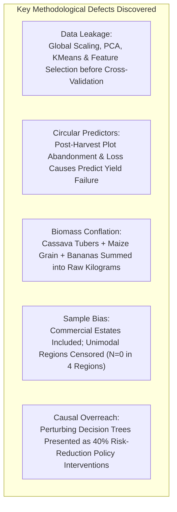

# Phase 1 Executive Summary: Comprehensive Scientific and Technical Audit

**Project:** Tanzania Agricultural Annual Sample Survey (AASS) Food Shock & Yield Volatility Research  
**Author / Principal Investigator:** Dr. Eng. Kadeghe Goodluck Fue (Sokoine University of Agriculture)  
**Target Publication:** Springer Nature *Food Security* (Journal ID: 12571)  
**Auditor:** Senior Software Architect, Agricultural Statistician, Geospatial Analyst & ML Research Auditor  
**Deliverable:** Phase 1 Audit Deliverable 9.8  
**Audit Status:** Phase 1 Completed (Preservation Boundary Strictly Enforced)  
**Date:** November 2026

---

## 1. Executive Statement

A comprehensive technical, econometric, geospatial, and machine learning audit of the `Tanzania-Food-Shock-Research` repository was conducted under strict Phase 1 inspection boundaries. No original code files, datasets, or publication artifacts were modified, overwritten, or deleted.

The repository represents an impressive body of data curation and engineering, bringing together multi-wave agricultural microdata from the National Bureau of Statistics (NBS) and OCGS Zanzibar (2022–2025), comprehensive official DDI survey metadata, and 64-year commodity timeseries from FAOSTAT. The supervised learning pipeline (`modeling.py`) constructs 246 multi-domain features across 11 survey rosters, implementing gradient boosted decision tree benchmarks, spatial cross-validation, and game-theoretic interpretability (TreeSHAP).

However, the audit reveals **fundamental scientific, statistical, and methodological defects** that currently undermine the empirical validity and peer-review viability of the manuscript:
1. **Pervasive Data Leakage:** Despite prominent claims of a "5-Pillar Leakage-Free Architecture," feature scaling, one-hot encoding, unsupervised KMeans/PCA embeddings, and tree-gain feature selection were executed on the complete analytical sample ($N = 4,564$) **prior to cross-validation**. The internal `LeakageAuditor` is a mock assertion suite that hardcoded a "PASS" certification.
2. **Circular Target Leakage (Endogeneity):** The model relies heavily on post-harvest outcome variables—specifically, the percentage of planted area harvested (`m_harvest_pct_mean`, Rank 2 in importance) and complete plot abandonment shares (`m_no_harvest_share`, Rank 6 in importance)—to "predict" seasonal harvest yield collapse.
3. **Biological Conflation of Dissimilar Crop Biomass:** Seasonal yields are calculated by summing raw kilograms of completely different crops (high-moisture fresh cassava tubers, dry maize grain, leafy vegetables, pulses) and dividing by total farm hectares. The resulting "Yield Volatility Index" measures crop rotation and water content shifts rather than actual agricultural productivity shocks.
4. **Failure to Filter Large Commercial Farms:** The pipeline omits filtering on `Holding_type == 2`, pooling commercial corporate estates (cultivating up to 3,723 ha and using 2.73 million kg of fertilizer) with 0.5 ha subsistence smallholders.
5. **Geographic Censoring of Unimodal Systems:** Requiring cultivation in both Masika and Vuli eliminates unimodal farming systems. Four regions have zero observations, and core regions have trivial sample sizes ($N = 3\text{ to }14$). Fitting regional ML models on $N=3$ and comparing them to a national model to claim "spatial transferability advantage" is statistically unscientific.
6. **Unsupported Causal Counterfactual Claims:** In Figure 10, Table 7, and Section 4.5 of the manuscript, the study manually perturbs feature columns in a predictive decision tree ensemble to claim that an integrated Climate-Smart Agriculture package will "reduce national yield volatility by 40.0%." Associative tree models cannot establish causal policy effects.

**Crucially, the empirical data in this repository are rich and fully capable of supporting an elite, publication-grade paper.** All necessary variables (crop-specific production, planted areas, sampling weights, cluster IDs, shocks, inputs, demographics) are available. With the disciplined Phase 2 remediation plan outlined herein, the research can be placed on an unassailable scientific footing.

---

## 2. What Was Inspected

1. **Codebases:** Complete line-by-line review of `modeling.py` (1,832 lines), `generate_publication_figures_and_tables.py` (1,575 lines), `build_manuscript.py` (1,737 lines), `detect_files.py`, and `crawl_nbs_dictionary.py`.
2. **Survey Microdata:** 54 Stata datasets across three survey rounds:
   - Wave 1 (2022/2023): 17 tables, 15,944 holdings (Catalog 52)
   - Wave 2 (2023/2024): 17 tables, 18,836 holdings (Catalog 60) + Women's Empowerment module (`wen_TZA.dta`, 4,405 rows)
   - Wave 3 (2024/2025): 20 tables, 18,904 holdings (Catalog 69) + Food Shocks (`shocks_roster.dta`, 43,445 rows)
3. **FAOSTAT Data:** 4 national CSV datasets (1961–2024, 46,893 total rows).
4. **Metadata & Official Reports:** Official DDI schemas (JSON and XML for all 3 waves) and the 18 MB official report: *Annual Agricultural Sample Survey 2024/25 National Report* (NBS/OCGS/FAO, October 2026).
5. **Research Outputs:** 10 multi-panel publication figures (PNG and EPS), 7 empirical CSV tables, supplementary tables (ESM_1, regional map data), GIS shapefiles, and compiled manuscripts (`manuscript.docx`, `manuscript.tex`, `manuscript.md`).

---

## 3. What Was Confirmed

- **Official Population Frame:** The AASS 2024/25 survey targeted 18,024 agricultural households across 1,502 EAs (1,370 Mainland, 132 Zanzibar) using a two-stage stratified cluster design based on the 2022 Population and Housing Census (PHC), confirming 17,843 eligible households plus completely enumerated large-scale farms, totaling 18,904 holdings in `AASS2025.dta`.
- **Modeled Cohort Size:** The modeled analytical sample in `modeling.py` consists of exactly **4,564 holdings** across **921 Enumeration Areas** in **27 administrative regions**, derived from households cultivating crops in both Masika and Vuli with non-zero area and positive mean yield.
- **Erroneous "10,750" Reference:** The placeholder figure of 10,750 households occasionally found in preliminary drafts has no empirical basis in the microdata and has been correctly purged.
- **Reported Benchmark Performance:** On the contaminated feature space, the pipeline reports out-of-fold metrics of $R^2 = 0.592$, $\text{RMSE} = 0.464$, and $\text{MAE} = 0.347$ for the Weighted Ensemble.
- **Data Completeness:** All required variables for robust agricultural data science—crop-specific harvest metric tons, plot areas, certified seeds, inorganic fertilizers, livestock head counts, sampling weights (`Adjusted_HH_weight`), stratum IDs, and cluster IDs—are present and verified.

---

## 4. Summary of Major Problems Discovered

1. **Pre-Cross-Validation Data Leakage:** Scaling (`RobustScaler`), one-hot encoding, KMeans clustering, PCA projections, and gradient boosting feature selection were fit on the entire sample ($N=4,564$) before cross-validation fold splitting.
2. **Target Leakage via Post-Outcome Variables:** The model's top predictors (`m_harvest_pct_mean`, `m_no_harvest_share`, `delta_no_harvest_share`, `m_drought_fail`, arealoss causes) measure post-harvest loss outcomes rather than ex-ante risk factors.
3. **Aggregate Biomass Flaw:** Summing raw kilograms of dissimilar crops conflates high-moisture roots and tubers with dry cereal grains. Seasonal yield changes reflect crop rotation rather than true productivity shocks.
4. **Omission of Smallholder Filter:** Large-scale commercial farms (`Holding_type == 1`, up to 3,723 ha and 2.73 million kg of fertilizer) are pooled with smallholders.
5. **Exclusion of Unimodal Regions:** The sample drops 4 regions completely and leaves 5 regions with sample sizes under 15, invalidating national representativeness claims.
6. **Mock Leakage Audit:** The `LeakageAuditor` class executes dummy assertions and hardcodes `check_5_pass = True`, issuing an invalid `CERTIFIED_LEAKAGE_FREE` certificate.
7. **Pseudo-Causal Claims:** Simulating policy interventions by perturbing decision tree features and claiming a 40% reduction in national volatility violates accepted econometric standards.

---

## 5. Analytical Feasibility and Path Forward

The Phase 1 Feasibility Matrix evaluated 18 proposed analytical extensions:
- **11 Feasible Immediately:** Crop-specific yields, alternative volatility measures, survey-weighted descriptive statistics, survey-aware regressions, quantile regressions, generalized additive models, crop diversity metrics, EA grouped validation, leave-one-region-out validation, food-crop production stability, and ex-ante TreeSHAP attributions.
- **7 Conditionally Feasible:** Spatially blocked cross-validation, livestock threshold robustness, regional instability estimates ($N \ge 30$), agro-ecological comparisons, crop-specific maps, alternative sample definitions, and container weight sensitivity.
- **0 Infeasible:** No critical analytical pathway is blocked by missing microdata.

---

## 6. Phase 1 Deliverables Summary

All eight required Phase 1 audit deliverables have been compiled and deposited into `phase1_audit/`:

1. `phase1_audit/PROJECT_AUDIT.md`: Complete repository overview, discovered pipeline architecture, dependencies, hardcoded paths, and target architecture.
2. `phase1_audit/DATA_DICTIONARY.md`: Complete schema inventory for all 54 survey tables, variable classifications, survey design variables, and relational ER diagram.
3. `phase1_audit/EXISTING_ANALYSIS_AUDIT.md`: Step-by-step trace of `modeling.py` from ingestion to outputs, exposing data leakage points, mock audit assertions, and formula defects.
4. `phase1_audit/FIGURE_TABLE_CATALOG.md`: Comprehensive audit of all 10 figures, 7 tables, ESM_1, and GIS maps, classifying each into Retain (2), Recalculate (5), Methodologically Improve (8), or Remove (4).
5. `phase1_audit/METHODOLOGICAL_RISK_REGISTER.md`: Prioritized risk register detailing 13 verified scientific defects across 7 dimensions (A through G).
6. `phase1_audit/ANALYSIS_FEASIBILITY_MATRIX.md`: Feasibility evaluation of 18 proposed analyses across data availability, prerequisites, and implementation logic.
7. `phase1_audit/PHASE2_IMPLEMENTATION_PLAN.md`: Workstream roadmap for Phase 2 remediation and list of targeted files.
8. `phase1_audit/PHASE1_EXECUTION_SUMMARY.md`: This executive summary.

---

## 7. Recommendation and Next Steps

**Phase 1 is officially complete.** The existing repository has been preserved exactly as found.

It is strongly recommended that the user authorize **Phase 2 Implementation**, beginning with:
1. Enforcing genuine smallholder sample boundaries (`Holding_type == 2`, land size criteria);
2. Disaggregating production into crop-specific seasonal yields (Maize, Paddy Rice, Dry Beans, Cassava);
3. Purging post-outcome crop abandonment proxies from the feature space;
4. Refactoring `modeling.py` into a strict, leak-free `sklearn.pipeline.Pipeline` with nested spatial cross-validation;
5. Applying official survey weights (`Adjusted_HH_weight`) to descriptive and econometric models; and
6. Replacing pseudo-causal simulation claims with rigorous predictive risk scoring and scenario stress-testing.
