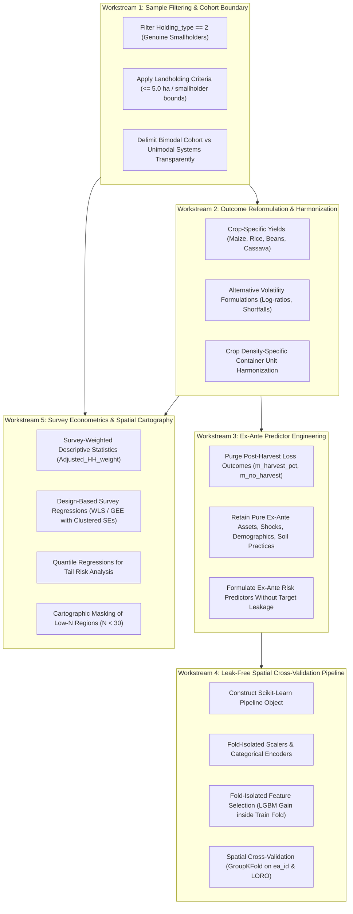

# Phase 2 Implementation and Remediation Plan

**Project:** Tanzania Agricultural Annual Sample Survey (AASS) Yield Volatility Research  
**Target Journal:** Springer Nature *Food Security*  
**Auditor Role:** Senior Software Architect, Agricultural Statistician, Geospatial Analyst & ML Research Auditor  
**Deliverable:** Phase 1 Audit Deliverable 9.7  
**Date:** November 2026

---

## 1. Objectives of Phase 2

Phase 2 will systematically resolve all critical and high-severity vulnerabilities identified during the Phase 1 inspection. The objective is to transform the existing empirical codebase into a **leakage-free, survey-calibrated, scientifically defensible agricultural data science framework** suitable for publication in an elite international peer-reviewed journal.

**Core Principles for Phase 2:**
1. Maintain documentation integrity and statistical transparency.
2. Replace all mock/pseudo-audits with genuine leak-free cross-validation pipelines.
3. Eliminate circular post-outcome variables from predictive feature spaces.
4. Harmonize crops by species and moisture characteristics rather than pooling raw biomass.
5. Apply official sampling weights to all descriptive and econometric estimations.
6. Reframe predictive machine learning models as associative risk-profiling tools, completely eliminating unsupported causal counterfactual claims.

---

## 2. Prioritized Implementation Workstreams

---

## 3. Workstream Details and Step-by-Step Actions

### Workstream 1: Sample Construction and Filtering
- **Action 1.1:** Filter out large-scale commercial farming corporations by enforcing `Holding_type == 2` (household holdings) across all data preparation scripts.
- **Action 1.2:** Establish an explicit smallholder landholding boundary (e.g., total farm area $\le 5.0\text{ ha}$) to eliminate extreme land-capitalization outliers.
- **Action 1.3:** Formally document the bimodal inclusion criteria, explicitly reporting that households cultivating in both Masika and Vuli represent bimodal farming zones.
- **Action 1.4:** Separately analyze unimodal agricultural households as a distinct empirical cohort (characterizing single-season production stability) rather than silently dropping them.

### Workstream 2: Crop-Specific Yield and Outcome Reformulation
- **Action 2.1:** Disaggregate seasonal production into core strategic food crops:
  - Cereal staple: Maize (*Zea mays*)
  - Secondary cereal: Paddy Rice (*Oryza sativa*)
  - Legume protein: Dry Beans (*Phaseolus vulgaris*)
  - Drought-tolerant root crop: Cassava (*Manihot esculenta*)
- **Action 2.2:** Calculate clean crop-specific yields:
  $$Y_{c,s,i} = \frac{\text{Production\_kg}_{c,s,i}}{\text{Planted\_Area\_ha}_{c,s,i}}$$
  accounting for plot allocation percentages ($s7q02$ in Masika, $s5q02$ in Vuli).
- **Action 2.3:** Formulate alternative yield stability metrics:
  - Normalized yield difference: $Y_{\text{vol},c} = \frac{|Y_{c,m} - Y_{c,v}|}{\frac{1}{2}(Y_{c,m} + Y_{c,v}) + \epsilon}$ (within crop $c$)
  - Log-yield ratio: $\ln\left(\frac{Y_{c,m} + 1}{Y_{c,v} + 1}\right)$
  - Seasonal production shortfall: $\max(0, Y_{c,m} - Y_{c,v})$
- **Action 2.4:** Update `UNIT_TO_KG_FACTORS` to utilize commodity-specific bulk densities derived from official NBS/FAO crop measurement conversion manuals.

### Workstream 3: Ex-Ante Predictor Engineering and Tautology Purging
- **Action 3.1:** Audit the 246 candidate predictors and immediately purge all post-outcome loss variables:
  - Remove `m_harvest_pct_mean`, `m_harvest_pct_min`
  - Remove `m_no_harvest_share`, `v_no_harvest_share`, `delta_no_harvest_share`
  - Remove `m_drought_fail`, `v_drought_fail`, `m_pest_fail`, `v_pest_fail`
  - Remove `m_arealoss_reason_1` through `m_arealoss_reason_10`
- **Action 3.2:** Re-engineer genuine ex-ante predictive predictors:
  - Pre-planting farm assets: TLU, farm equipment, labor availability, land endowments
  - Pre-planting climatic exposure: Historical regional rainfall anomalies, baseline shock history
  - Early-season management: Planting date timing, certified seed adoption, baseline irrigation infrastructure
  - Crop diversity: Baseline Shannon diversity, crop species count, evenness

### Workstream 4: Leak-Free Spatial Machine Learning Pipeline
- **Action 4.1:** Encapsulate all feature transformations in a scikit-learn `Pipeline` or custom fold-isolated orchestrator.
- **Action 4.2:** Fit `RobustScaler` and `OneHotEncoder` strictly on training fold indices (`train_idx`), applying `.transform()` to validation fold indices (`val_idx`).
- **Action 4.3:** Fit unsupervised representation models (`KMeans`, `PCA`) strictly inside training folds.
- **Action 4.4:** Re-implement feature selection inside cross-validation: evaluate feature importance on training slices only; do not expose validation targets to tree-gain pruning.
- **Action 4.5:** Execute dual spatial validation schemes:
  - Primary: 5-Fold `GroupKFold` on Enumeration Areas (`ea_id`)
  - Secondary: Leave-One-Region-Out (`LeaveOneGroupOut` on `region_id`) to test macro spatial transferability.
- **Action 4.6:** Retire `LeakageAuditor` mock checks; document actual fold isolation programmatically.

### Workstream 5: Survey Econometrics and Statistical Rigor
- **Action 5.1:** Recompute Table 1 summary statistics using official sampling weights (`Adjusted_HH_weight`), reporting population-calibrated means, standard deviations, and quintiles.
- **Action 5.2:** Fit survey-weighted linear regressions and Generalized Linear Models (GLMs) with cluster-robust standard errors adjusted for PSU clustering (`ea_id`) and regional strata (`stratum_id`).
- **Action 5.3:** Fit Quantile Regressions ($\tau = 0.10, 0.25, 0.50, 0.75, 0.90$) to assess how asset buffers and crop diversity protect smallholders against extreme tail risk.
- **Action 5.4:** Implement Generalized Additive Models (GAMs) with spline bases to statistically verify non-linear response curves and asset thresholds (e.g., TLU tipping points) with 95% confidence bands.

### Workstream 6: Geospatial Analysis and Cartography
- **Action 6.1:** Suppress or flag regional models with sample sizes $N < 30$ in regional performance tables and charts.
- **Action 6.2:** In GIS choropleth maps (Figure 8), apply hatching or grey masking to regions with insufficient sample size ($N < 30$) or zero observations (Ruvuma, Rukwa, Lindi, Mtwara).
- **Action 6.3:** Explicitly delineate bimodal vs. unimodal agro-ecological zones on national maps.

### Workstream 7: Ethical and Responsible Model Interpretability
- **Action 7.1:** Recompute TreeSHAP attributions on the leak-free, clean model trained solely on ex-ante predictors.
- **Action 7.2:** Remove Figure 10, Table 7, and all claims of "40% volatility reduction" from policy counterfactual simulations.
- **Action 7.3:** Reframe interpretability sections around predictive risk profiling, associative vulnerability scoring, and early-warning screening.

---

## 4. Files Targeted for Phase 2 Modification

To maintain strict execution boundaries, **no existing files were modified in Phase 1**. In Phase 2, the following files will be refactored or created:

| File Path | Role in Phase 2 | Planned Modifications |
|---|---|---|
| `modeling.py` | Core Analytical Engine | Refactor into leak-free `sklearn.pipeline.Pipeline`; filter `Holding_type == 2`; disaggregate crop yields; nest feature selection inside cross-validation; purge post-outcome loss variables; eliminate mock audit class. |
| `generate_publication_figures_and_tables.py` | Visual & Table Generator | Update to consume clean pipeline outputs; regenerate Figures 1–9 with crop-specific disaggregations and masked low-N regions; remove Figure 10 and Table 7; regenerate Tables 1–6 with survey weights. |
| `build_manuscript.py` | Manuscript Compiler | Update table and figure embedding routines; remove references to Figure 10 and Table 7; update text blocks to reflect revised empirical findings and leak-free metrics. |
| `Paper/manuscript.md` | Primary Text | Rewrite Methods and Results sections; update abstract with true leak-free $R^2$ and RMSE; remove causal claims; expand discussion on unimodal vs bimodal systems. |
| `Paper/manuscript.tex` | LaTeX Source | Synchronize with updated `manuscript.md`. |
| `Paper/manuscript.docx` | Word Deliverable | Recompile via `build_manuscript.py`. |
| `Paper/publication_defense_dossier.md` | Reviewer Defense | Rewrite defense dossier to present a transparent, unassailable accounting of data leakage elimination, survey weighting, and crop-specific modeling. |

---

## 5. Phase 2 Milestone Schedule

1. **Milestone 2.1:** Data Cleaning & Crop-Specific Extraction Engine complete.
2. **Milestone 2.2:** Leak-Free Spatial Cross-Validation Pipeline operational.
3. **Milestone 2.3:** Survey-Weighted Descriptive and Econometric Models estimated.
4. **Milestone 2.4:** Revised Figures (1–9) and Tables (1–6) generated.
5. **Milestone 2.5:** Manuscript text and defense dossier fully synchronized for journal submission.
