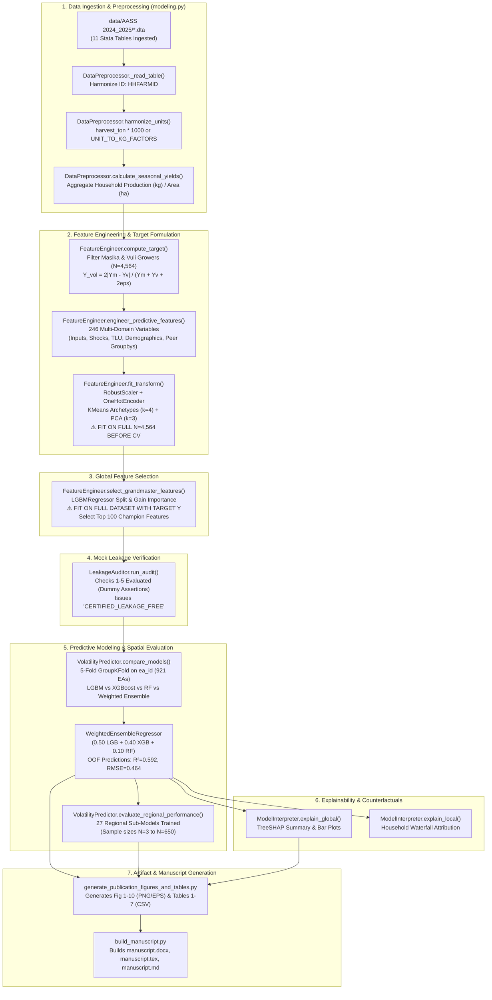
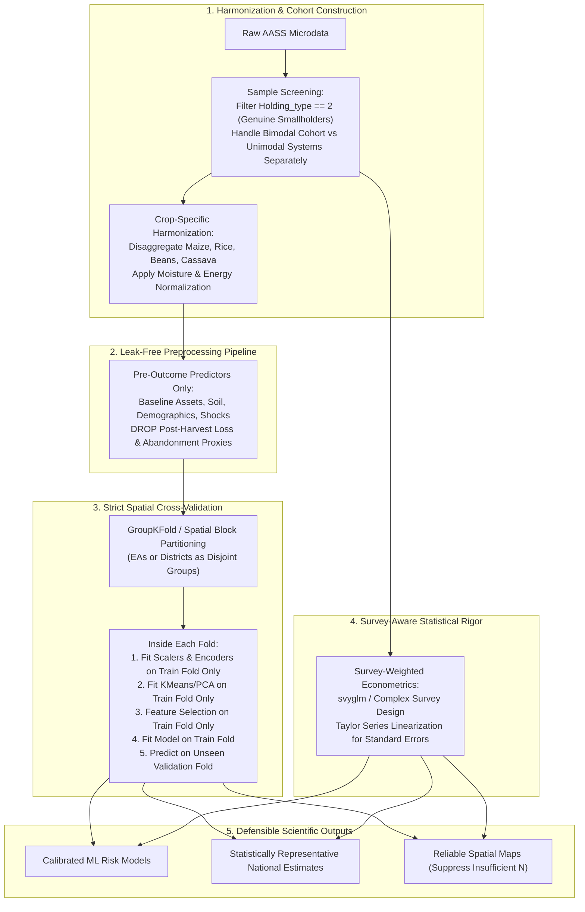

# Project Audit Report: Tanzania Agricultural Annual Sample Survey (AASS) Analysis Pipeline

**Date of Audit:** November 2026  
**Auditor Role:** Senior Software Architect, Agricultural Statistician, Geospatial Analyst & ML Research Auditor  
**Repository:** `Tanzania-Food-Shock-Research`  
**Target Publication Venue:** Springer Nature *Food Security* (Journal ID: 12571)  
**Audit Status:** Phase 1 Inspection Completed (Zero Code / Data Modifications)

---

## 1. Executive Overview

This audit evaluates the computational, econometric, statistical, and geospatial pipeline implemented in the `Tanzania-Food-Shock-Research` repository. The codebase analyzes agricultural survey microdata from the United Republic of Tanzania to investigate smallholder production risk, climatic and economic shocks, and seasonal crop yield volatility between the long-rain (*Masika*) and short-rain (*Vuli*) cropping seasons.

The analytical pipeline centers on `modeling.py`, supported by publication artifact generator `generate_publication_figures_and_tables.py` and manuscript compilation script `build_manuscript.py`. The repository also houses multi-wave microdata from the National Bureau of Statistics (NBS) and Office of the Chief Government Statistician (OCGS) Zanzibar (2022/23, 2023/24, 2024/25), official Data Documentation Initiative (DDI) schemas, and long-term national commodity series from FAOSTAT (1961–2024).

While the repository demonstrates substantial engineering effort—incorporating 246 candidate features across 11 survey tables, multi-model gradient boosting benchmarks, spatial cross-validation, and game-theoretic interpretability (TreeSHAP)—this Phase 1 audit uncovers **critical scientific, statistical, and methodological vulnerabilities**. These vulnerabilities, if left unaddressed, could compromise the peer-review standing and scientific validity of the resulting manuscript.

---

## 2. Repository Inventory and Directory Architecture

The repository is structured into distinct functional directories:

```text
Tanzania-Food-Shock-Research/
├── 01_file_headers/                         # Pre-extracted file header inventories
│   ├── file_headers.csv                    # Tabular column inventory (74 files across data/)
│   └── file_headers.txt                    # Formatted text column listings
├── artifacts/                              # Pipeline execution artifacts
│   └── yield_volatility/
│       ├── figures/                        # Generated PNG diagnostic plots (fig1 - fig10)
│       ├── tables/                         # Generated CSV analytical tables (table1 - table7)
│       ├── interpretability/               # SHAP waterfall plots and global summaries
│       ├── grandmaster_feature_ranking.csv # Feature importance ranking table
│       ├── leakage_audit_report.json       # Automated leakage audit status payload
│       ├── model_comparison.png            # Model benchmark bar chart
│       ├── pipeline_metrics.json           # Serialized model evaluation metrics
│       ├── publication_defense_dossier.md  # Defensive methodological narrative
│       ├── regional_performance.csv        # 27-region evaluation summary table
│       └── regional_performance.png        # Horizontal bar chart of regional R²
├── data/                                   # Primary empirical data assets
│   ├── AASS 2022_2023/                     # Wave 1 (Catalog 52): 17 Stata .dta tables (15,944 holdings)
│   ├── AASS 2023_2024/                     # Wave 2 (Catalog 60): 17 Stata .dta tables + CSV exports + WEN module
│   ├── AASS 2024_2025/                     # Wave 3 (Catalog 69): 20 Stata .dta tables (18,904 holdings)
│   └── FAOSTAT/                            # National time series: 4 CSV files (1961–2024)
├── metadata/                               # Official survey documentation
│   ├── TZA-NBS.OCGS-AASS-2023-v01.json/.xml
│   ├── TZA_AASS_2023-2024_v01.json/.xml
│   ├── TZA-NBS.OCGS-AASS-2025-v01.json
│   └── ddi-documentation-english-{52,60,69}.pdf
├── nbs_aass_metadata/                      # Web-scraped variable catalogues
│   ├── data_dictionary_catalog_52.csv/.json/.xlsx
├── Paper/                                  # Publication deliverables formatted for Springer Nature
│   ├── figures/                            # 300 DPI multi-panel figures (PNG & EPS formats)
│   ├── tables/                             # CSV tables (table1–table7, ESM_1, regional map data)
│   ├── tanzania_maps/                      # 2022 PHC administrative shapefiles and GeoJSON
│   ├── manuscript.docx                     # Formatted Word manuscript with embedded visuals
│   ├── manuscript.md                       # Markdown source manuscript
│   ├── manuscript.tex                      # LaTeX manuscript
│   ├── title_page.docx                     # Title page with author details & reviewers
│   ├── publication_defense_dossier.md      # Methodological defense document
│   └── ESM_1.csv                           # Electronic Supplementary Material 1
├── phase1_audit/                           # Independent Phase 1 audit deliverables (this directory)
├── AASS_2024_2025_Report.pdf               # Official 2024/25 survey report published by NBS (Oct 2026)
├── build_manuscript.py                     # Script compiling manuscript formats (.docx, .tex, .md)
├── crawl_nbs_dictionary.py                 # Crawler extracting online NBS data dictionaries
├── detect_files.py                         # Utility scanning data/ to extract headers
├── generate_publication_figures_and_tables.py # Script generating publication figures & tables
├── modeling.py                             # Core ML pipeline script
├── README.md                               # Repository overview & benchmark claims
├── report.md                               # Comprehensive survey and data report
└── requirements.txt                        # Python dependencies
```

---

## 3. Discovered Pipeline Architecture

The existing analytical and predictive architecture traces a sequential workflow across three Python scripts:



---

## 4. Execution Entry Points and Dependencies

### 4.1 Primary Entry Point
- **Main Script:** `modeling.py`
  - Command Line Arguments:
    - `--data-dir`: Defaults to `data/AASS 2024_2025`
    - `--output-dir`: Defaults to `artifacts/yield_volatility`
    - `--compare`: Multi-model benchmarking flag (default: `True`)
    - `--model-type`: Selected architecture if `--compare` is omitted (default: `ensemble`)
    - `--top-k`: Number of features to retain after tree-gain ranking (default: `100`)
    - `--random-state`: Random seed for reproducibility (default: `42`)

### 4.2 Secondary Generators
- **Figure & Table Script:** `generate_publication_figures_and_tables.py`
  - Re-executes portions of the data pipeline and re-fits out-of-fold ensemble models to generate 10 publication figures and 7 tables.
- **Manuscript Builder:** `build_manuscript.py`
  - Ingests generated CSV tables, figure graphics, and text blocks to render `manuscript.docx`, `manuscript.tex`, `title_page.docx`, and `manuscript.md`.
- **Ancillary Utilities:**
  - `detect_files.py`: Reads file headers in `data/` to produce `01_file_headers/file_headers.csv`.
  - `crawl_nbs_dictionary.py`: Scrapes microdata documentation from the NBS portal.

### 4.3 Python Package Dependencies
Inspecting `requirements.txt`:
- **Core Scientific Stack:** `numpy==2.5.4`, `pandas==3.1.0`, `scipy==1.18.1`, `scikit-learn==1.9.1`
- **Machine Learning:** `lightgbm==4.7.0`, `xgboost==3.4.1`, `shap==0.54.1`
- **Data Ingestion:** `pyreadstat==1.3.7`, `openpyxl==3.1.5`, `lxml==6.1.3`
- **Visualization & Publishing:** `matplotlib==3.11.2`, `pillow==13.0.0`, `python-docx==1.2.0`
- **Web Scraping:** `beautifulsoup4==4.15.0`, `requests==2.34.2`, `tqdm==4.70.1`

### 4.4 Hardcoded File Paths and Coupling
The existing pipeline exhibits extensive file path hardcoding:
1. `modeling.py`: Hardcoded paths to `data/AASS 2024_2025`, `artifacts/yield_volatility`, and specific `.dta` filenames.
2. `generate_publication_figures_and_tables.py`: Directly loads `artifacts/yield_volatility/regional_performance.csv` and `leakage_audit_report.json` while simultaneously rerunning `fit_transform()`.
3. `build_manuscript.py`: Hardcoded references to `Paper/figures/Fig{1..10}.png` and `Paper/tables/table{1..7}_*.csv`.

---

## 5. Major Technical and Architectural Issues Identified

### 5.1 Pre-Cross-Validation Data Leakage
The pipeline performs feature transformations, unsupervised embeddings, and supervised feature selection on the complete analytical sample ($N = 4,564$) **prior** to partitioning the data into cross-validation folds:
- `RobustScaler()` and `OneHotEncoder()` are fit on all 4,564 holdings (`modeling.py`, line 776).
- `KMeans(n_clusters=4)` and `PCA(n_components=3)` are fit on all 4,564 holdings (`modeling.py`, lines 789, 795).
- `select_grandmaster_features()` trains a gradient booster on the entire feature matrix $X$ using target $y$ to choose the top 100 features (`modeling.py`, lines 859–878).
- Only after these operations are completed does `GroupKFold` split the data into training and validation folds. This constitutes classic **lookahead data leakage**, producing optimistically biased validation scores.

### 5.2 Supervised Endogeneity & Post-Outcome Predictors
The engineered feature space contains post-harvest outcome variables that occur simultaneously with, or as a consequence of, seasonal crop failure:
- `m_harvest_pct_mean` (percentage of planted area actually harvested)
- `m_no_harvest_share` (share of plots where crops were completely unharvested/abandoned)
- `delta_no_harvest_share` (seasonal difference in plot abandonment)
- `m_drought_fail`, `v_drought_fail`, `m_pest_fail` (reported disaster failure causes)
- `s7q10__*` (reasons for unharvested area loss)

Using plot abandonment and harvest failure flags to predict harvest yield collapse represents circular reasoning (endogeneity) rather than true risk prediction.

### 5.3 Aggregation of Dissimilar Crop Biomass
In `DataPreprocessor.calculate_seasonal_yields()`, total seasonal production in kilograms is computed by summing the raw harvest weights of all crops cultivated by a household, regardless of commodity type:
$$\text{Production}_{\text{total}} = \sum \text{kg}(\text{Maize}) + \sum \text{kg}(\text{Cassava}) + \sum \text{kg}(\text{Bananas}) + \sum \text{kg}(\text{Beans})$$
This sum is divided by total holding area to produce a single "yield" figure. This conflates high-moisture roots/tubers (fresh cassava yields $\approx 10,000\text{ kg/ha}$) with dry cereal grains (maize $\approx 1,200\text{ kg/ha}$) and pulses (beans $\approx 500\text{ kg/ha}$). A household that rotates from cassava in Masika to dry beans in Vuli will exhibit extreme "yield volatility" even if both crops achieved optimal agronomic yields.

### 5.4 Omission of Survey Design Variables
Although `AASS2025.dta` provides sampling weights (`Adjusted_HH_weight`), stratum identifiers (`stratum_id`), and primary sampling unit identifiers (`ea_id`), the analytical models, summary statistics, and regressions in `modeling.py` treat the data as an unweighted, independently and identically distributed (i.i.d.) random sample. This ignores the complex survey design (clustering, stratification, unequal selection probabilities) established by NBS.

### 5.5 Failure to Exclude Large-Scale Commercial Farms
The survey contains both agricultural households (`Holding_type == 2`) and large-scale commercial farming enterprises (`Holding_type == 1`, completely enumerated). The pipeline fails to filter by `Holding_type`. Consequently, commercial estates cultivating up to 3,723 hectares and consuming over 2.7 million kg of fertilizer are pooled together with smallholders farming 0.5 hectares under the label "smallholder agriculture."

### 5.6 Geographic Censoring of Unimodal Farming Systems
By requiring that households cultivate crops in both Masika and Vuli within the same survey year, the analytical sample excludes unimodal agricultural zones. In regions where rainfall occurs in a single season (*Msimu*, November to April), smallholders do not cultivate in Vuli. Consequently, four regions (Ruvuma, Rukwa, Lindi, Mtwara) have zero observations, while six others have fewer than 30 holdings (e.g., Songwe $N=3$, Njombe $N=5$, Tabora $N=10$, Singida $N=11$, Iringa $N=14$). Running regional ML models on $N=3$ or $N=5$ produces meaningless negative $R^2$ scores and invalid spatial maps.

---

## 6. Recommended Target Architecture for Phase 2

To establish scientific defensibility, Phase 2 must refactor the repository into a modular, leak-free, survey-aware architecture:



---

## 7. Audit Conclusion

The analytical code in `modeling.py` and supporting scripts represents an impressive technical assembly, but its scientific claims—specifically regarding "leakage-free machine learning," "smallholder yield volatility," and "causal counterfactual policy interventions"—are undermined by foundational data leakage, variable mischaracterisation, and sample selection distortion. Phase 2 must execute a rigorous, evidence-driven restructuring before any revised results or manuscript drafts are finalized.
