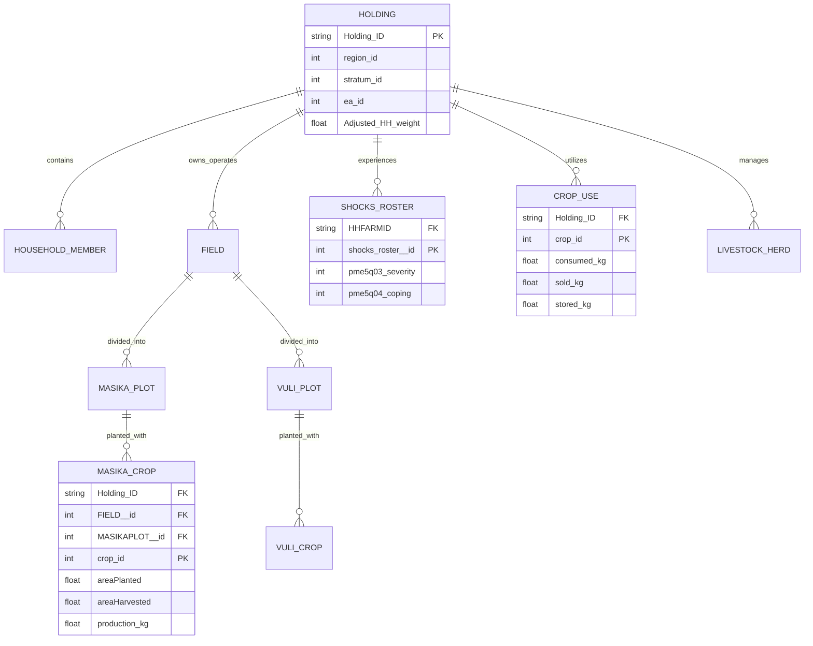

# Comprehensive Data Report: NBS Microdata & FAOSTAT Datasets for Tanzania Food Shock Research

**Author:** Kadeghe Goodluck Fue (<kadefue@sua.ac.tz>)  
**Institution:** Sokoine University of Agriculture (SUA)  
**Scope:** Multi-Wave Household Agricultural Microdata (2022–2025) and Macroeconomic Timeseries (1961–2024)  
**Date of Assessment:** October 2026  

---

## Table of Contents
1. [Executive Summary](#1-executive-summary)
2. [Data Landscape & Conceptual Framework](#2-data-landscape--conceptual-framework)
3. [Tanzania NBS & OCGS Microdata (AASS Waves 2022–2025)](#3-tanzania-nbs--ocgs-microdata-aass-waves-20222025)
   - [3.1 Administrative Framework & Sampling Methodology](#31-administrative-framework--sampling-methodology)
   - [3.2 Wave 1: AASS 2022/2023 (Catalog 52)](#32-wave-1-aass-20222023-catalog-52)
   - [3.3 Wave 2: AASS 2023/2024 (Catalog 60)](#33-wave-2-aass-20232024-catalog-60)
   - [3.4 Wave 3: AASS 2024/2025 (Catalog 69)](#34-wave-3-aass-20242025-catalog-69)
   - [3.5 Deep-Dive: The Food Shock Module (`shocks_roster.dta`)](#35-deep-dive-the-food-shock-module-shocks_rosterdta)
   - [3.6 Seasonality Structure: *Masika* vs. *Vuli* Dynamics](#36-seasonality-structure-masika-vs-vuli-dynamics)
   - [3.7 Relational Schema & Linkage Architecture](#37-relational-schema--linkage-architecture)
4. [FAOSTAT Tanzania Agricultural Statistics (1961–2024)](#4-faostat-tanzania-agricultural-statistics-19612024)
   - [4.1 Scope & Dataset Inventory](#41-scope--dataset-inventory)
   - [4.2 Priority Food Security Crops Analysis](#42-priority-food-security-crops-analysis)
   - [4.3 Macro-Level Trends & Historical Shock Signatures](#43-macro-level-trends--historical-shock-signatures)
5. [Micro-Macro Synthesis & Research Applications](#5-micro-macro-synthesis--research-applications)
   - [5.1 Cross-Scale Validation](#51-cross-scale-validation)
   - [5.2 Shock Transmission Pathways](#52-shock-transmission-pathways)
   - [5.3 Gender Empowerment & Resilience (`wen_TZA`)](#53-gender-empowerment--resilience-wentza)
   - [5.4 Institutional Interventions & Social Safety Nets](#54-institutional-interventions--social-safety-nets)
6. [Data Harmonization Nuances & Methodological Considerations](#6-data-harmonization-nuances--methodological-considerations)
7. [Econometric & Analytical Roadmap for Food Shock Research](#7-econometric--analytical-roadmap-for-food-shock-research)

---

## 1. Executive Summary

This report delivers a thorough empirical and architectural evaluation of the primary datasets assembled in this repository. The data infrastructure combines **micro-level, multi-stage stratified survey microdata** from the **Tanzania National Bureau of Statistics (NBS)** and the **Office of the Chief Government Statistician (OCGS) Zanzibar** with **macro-level historical agricultural timeseries** from the **Food and Agriculture Organization of the United Nations (FAOSTAT)**.

### Primary Empirical Assets at a Glance:
- **Annual Agricultural Sample Surveys (AASS)**: Three consecutive survey rounds covering the 2022/23, 2023/24, and 2024/25 agricultural years. The microdata encompasses over **53,600 agricultural holdings**, **258,000 household members**, and **180,000 plot-season cultivation records** across both Tanzania Mainland and Zanzibar.
- **Dedicated Food Shock Module (`shocks_roster.dta`)**: Documenting **43,445 shock exposure occurrences** across 15 distinct covariate and idiosyncratic shock categories, complete with physical/economic damage assessments, severity grading, and access to coping instruments.
- **Women's Empowerment in Nutrition & Agriculture (`wen_TZA.dta`)**: A specialized module containing 153 variables profiling time allocation, intra-household decision-making autonomy, and organizational leadership for female and male decision-makers.
- **FAOSTAT National Agricultural Series (1961–2024)**: 64 continuous years of national crop area harvested, yield, and production across 136 commodities, featuring strategic staples: maize (*Zea mays*), paddy rice (*Oryza sativa*), dry beans (*Phaseolus vulgaris*), and sorghum (*Sorghum bicolor*).

### Core Research Finding from Microdata Inspection:
In the 2024/25 survey wave, **87.3% of surveyed agricultural holdings (16,500 of 18,904)** reported experiencing at least one severe shock. Climatic hazards (drought, erratic rains, floods) and biological threats (pests and diseases) accounted for over 50% of all reported shocks. Critically, **97.0% of shock-affected households reported having no access to formal credit, informal credit, or insurance**, demonstrating an acute vulnerability gap that necessitates deep empirical research into household coping mechanisms and food system resilience.

---

## 2. Data Landscape & Conceptual Framework

Food shocks in Sub-Saharan smallholder systems operate across micro-, meso-, and macro-levels. Investigating their root causes, impacts, and transmission mechanisms requires integrating high-resolution microdata with long-term aggregate indicators:

```
+------------------------------------------------------------------------------------+
|                               FAOSTAT (1961 - 2024)                                |
|  - 64-Year Macro Trends in Production, Harvested Area, & Yield (136 Items)         |
|  - Identification of Macro Climatic Shocks (Droughts, El Nino, Macro Crises)       |
+------------------------------------------------------------------------------------+
                                         │
                         Aggregate Validation & Context
                                         ▼
+------------------------------------------------------------------------------------+
|                        Tanzania NBS & OCGS AASS Microdata                          |
|  - Wave 2022/2023 (Catalog 52): Baseline Structure, Inputs, Labor, Credit Access    |
|  - Wave 2023/2024 (Catalog 60): Women's Empowerment (WEN), Farm Buildings          |
|  - Wave 2024/2025 (Catalog 69): Shock Roster, Agro-Climate Information, Livestock  |
+------------------------------------------------------------------------------------+
        │                               │                               │
        ▼                               ▼                               ▼
+─────────────────+           +──────────────────+            +──────────────────+
| Household Level |           |   Plot & Season  |            |  Coping & Safety |
| - Demographics  |           | - Masika Season  |            | - Formal Credit  |
| - Food Programs |           | - Vuli Season    |            | - Informal Nets  |
| - Empowerment   |           | - Crop Loss/Yield|            | - Asset Distress |
+─────────────────+           +──────────────────+            +──────────────────+
```

---

## 3. Tanzania NBS & OCGS Microdata (AASS Waves 2022–2025)

### 3.1 Administrative Framework & Sampling Methodology

The **Annual Agricultural Sample Survey (AASS)** is the premier statistical instrument conducted jointly by the **National Bureau of Statistics (NBS)** of Tanzania Mainland and the **Office of the Chief Government Statistician (OCGS)** of Zanzibar.

#### Key Survey Methodological Attributes:
- **Coverage**: Nationally representative across all 31 administrative regions (26 on Tanzania Mainland and 5 in Zanzibar), encompassing rural and peri-urban smallholder and large-scale agricultural holdings.
- **Sampling Design**: Two-stage stratified cluster sampling:
  1. *Primary Sampling Units (PSUs)*: Enumeration Areas (EAs) selected with Probability Proportional to Size (PPS) from the National Master Sample (NMS) derived from the 2022 Population and Housing Census (PHC).
  2. *Secondary Sampling Units (SSUs)*: Agricultural households systematically selected within each selected EA, stratified into crop-only, livestock-only, mixed farming, and pastoralist holdings.
- **Weighting**: Individual sampling weights (`Weight`, `weight`, or `Adjusted_HH_weight`) are provided to inflate sample estimates to national and regional population totals.

---

### 3.2 Wave 1: AASS 2022/2023 (Catalog 52)

- **Official Identification**: `TZA-NBS.OCGS-AASS-2023-v01`
- **Data Dictionary Catalog**: Catalog 52
- **Core Files & Sample Sizes**:

| File Name | File Size | Observations | Columns | Content & Research Scope |
| :--- | :---: | :---: | :---: | :--- |
| `AASS2023.dta` | 5.62 MB | 15,944 | 46 | Holding-level demographics, agricultural credit access, loan reasons, repayments, and program participation. |
| `household.dta` | 14.74 MB | 76,863 | 25 | Individual household roster: age, sex, education, relationship to head, off-farm economic activities. |
| `field.dta` | 1.55 MB | 28,472 | 7 | Farm land tenure, plot allocation, and total holding area (in acres). |
| `masikacrop.dta` | 8.10 MB | 32,002 | 33 | Long rains (*Masika*) seasonal crop production, area planted, area harvested, and yield loss reasons. |
| `masikaplot.dta` | 7.15 MB | 25,896 | 36 | Plot-level characteristics, soil quality, slope, erosion control, and irrigation in *Masika*. |
| `masika_use.dta` | 1.98 MB | 36,296 | 7 | Post-harvest crop destination (home consumption, sold, stored, processed) for *Masika*. |
| `vulicrop.dta` | 6.95 MB | 28,300 | 32 | Short rains (*Vuli*) seasonal crop production, harvested volume, and crop loss factors. |
| `vuliplot.dta` | 5.63 MB | 20,405 | 36 | Plot-level characteristics, irrigation, and management during the *Vuli* season. |
| `vuli_use.dta` | 1.95 MB | 35,828 | 7 | Post-harvest destination for *Vuli* crops. |
| `crop_use.dta` | 6.38 MB | 36,147 | 23 | Annualized crop utilization, sales revenue, buyer channels, and post-harvest losses. |
| `inputs.dta` | 3.53 MB | 19,967 | 23 | Chemical/organic fertilizers, pesticides, herbicides, fungicides, and application rates. |
| `seeds.dta` | 7.04 MB | 36,667 | 25 | Seed variety adoption (local unimproved vs. certified/improved seeds), acquisition costs, and sourcing. |
| `external_labor_activities.dta` | 1.34 MB | 12,351 | 14 | Hired farm labor: person-days, wage rates (cash vs. in-kind), task specialization. |
| `permanent_crop.dta` | 1.27 MB | 8,201 | 20 | Tree crops and perennial agroforestry systems (banana, cashew, coffee, coconut). |
| `items_services.dta` | 0.93 MB | 13,300 | 9 | Agricultural equipment services, tractor rentals, storage fees, and transport costs. |
| `otherproducts.dta` | 0.67 MB | 5,755 | 15 | Secondary products (honey, charcoal, timber, straw, medicinal plants). |
| `aquaculture.dta` | 0.04 MB | 381 | 13 | Fish farming: ponds, cages, fingerlings, feeding, and harvested biomass. |

---

### 3.3 Wave 2: AASS 2023/2024 (Catalog 60)

- **Official Identification**: `TZA_AASS_2023-2024_v01`
- **Data Dictionary Catalog**: Catalog 60
- **Core Files & Sample Sizes**:

| File Name | File Size | Observations | Columns | Content & Research Scope |
| :--- | :---: | :---: | :---: | :--- |
| `AASS2024f.dta` | 2.21 MB | 18,836 | 16 | Holding-level identification, regional strata, sampling weights, and social program participation. |
| `HOUSEHOLD.dta` | 11.80 MB | 88,977 | 17 | Demographic structure of farm households across 18,836 holdings. |
| `FIELD.dta` | 0.98 MB | 29,390 | 4 | Field registration, area in hectares (`s3q04a_hectares`), tenure rights. |
| `MASIKACROP.dta` | 12.11 MB | 34,574 | 46 | Detailed *Masika* crop outputs, intercropping configurations, pest damage, and harvest volume. |
| `MASIKAPLOT.dta` | 9.04 MB | 27,917 | 42 | *Masika* plot agronomic management, fertilizer usage, soil amendments. |
| `VULICROP.dta` | 6.00 MB | 18,757 | 42 | *Vuli* crop harvest metrics, damage incidence, and seed rates. |
| `VULIPLOT.dta` | 5.02 MB | 15,495 | 42 | Agronomic plot management during the *Vuli* short rains. |
| `CROP_USE.dta` | 6.10 MB | 36,480 | 22 | Utilization, storage, sales, and post-harvest storage losses. |
| `InputRoster_masika.dta` | 0.47 MB | 15,694 | 4 | Input roster for *Masika* season. |
| `InputRoster_vuli.dta` | 0.16 MB | 5,192 | 4 | Input roster for *Vuli* season. |
| `buildings_roster.dta` | 8.64 MB | 17,566 | 64 | On-farm physical infrastructure: storage silos, granaries, animal sheds, fences, machinery sheds. |
| `wen_TZA.dta` | 5.82 MB | 4,405 | 153 | **Women's Empowerment in Nutrition & Agriculture (WEN)**: Comprehensive intra-household time-use, decision autonomy, income control, and group leadership. |
| `permanent_crop.dta` | 1.82 MB | 6,999 | 34 | Tree crops, perennial plantations, plantation area, and yields. |
| `sec16_otherproducts.dta`| 0.54 MB | 6,764 | 10 | Secondary farm produce and non-wood forest products. |
| `s17_aquaculture.dta` | 0.01 MB | 262 | 6 | Fish farming production indicators. |

---

### 3.4 Wave 3: AASS 2024/2025 (Catalog 69)

- **Official Identification**: `TZA-NBS.OCGS-AASS-2025-v01`
- **Data Dictionary Catalog**: Catalog 69
- **Core Files & Sample Sizes**:

| File Name | File Size | Observations | Columns | Content & Research Scope |
| :--- | :---: | :---: | :---: | :--- |
| `AASS2025.dta` | 2.89 MB | 18,904 | 35 | Master holding roster: agro-ecological practices (slash-and-burn, pollination, irrigation water deficits, pesticide safety), government extension visits, and participation in the **Tanzania Food System Resilience Programme (TFSRP)** and **PSSN**. |
| `shocks_roster.dta` | 9.21 MB | 43,445 | 19 | **Dedicated shock module**: 15 shock categories, physical and economic damage types, damage severity, and access to financial/insurance coping mechanisms. |
| `HOUSEHOLD.dta` | 1.79 MB | 92,945 | 9 | Household roster covering 92,945 individuals across 18,904 agricultural holdings. |
| `FIELD.dta` | 0.77 MB | 31,579 | 8 | Land parcels, distance from homestead, soil characteristics, ownership. |
| `MASIKACROP.dta` | 9.91 MB | 40,485 | 54 | Expanded *Masika* crop records: input usage, improved seeds, pest/disease outbreaks, yield. |
| `MASIKAPLOT.dta` | 14.33 MB | 31,497 | 59 | Agronomic inputs, mechanization, irrigation method, organic vs. synthetic fertilizer. |
| `VULICROP.dta` | 1.52 MB | 26,105 | 26 | *Vuli* season crop production and harvest statistics. |
| `VULIPLOT.dta` | 8.56 MB | 18,441 | 60 | *Vuli* plot characteristics and management. |
| `CROP_USE.dta` | 5.32 MB | 41,111 | 22 | Disposition of all harvested crops (food, feed, seed, barter, sales, wastage). |
| `inputRoster_masika.dta` | 0.51 MB | 19,648 | 4 | Itemized input applications for the long rains. |
| `inputRoster_vuli.dta` | 0.19 MB | 7,342 | 4 | Itemized input applications for the short rains. |
| `pme_6_Roster.dta` | 3.27 MB | 13,491 | 55 | **Climate information and advisory services**: Receipt of daily/monthly weather forecasts, onset of rains predictions, pest alerts, and commodity market prices. |
| `livestock_type.dta` | 12.45 MB | 30,142 | 74 | Livestock herd dynamics: births, live purchases, sales, slaughter, head prices, free gifts. |
| `stock_livestock.dta` | 2.39 MB | 58,142 | 6 | Herd inventory counts by species (cattle, goats, sheep, pigs, poultry). |
| `s14_milk.dta` | 1.11 MB | 9,992 | 17 | Dairy production: lactating cows, daily milking records in wet season vs. dry season, milk consumption vs. sales. |
| `permanent_crop.dta` | 0.78 MB | 13,885 | 24 | Perennial crop inventory and yield metrics. |
| `s17_aquaculture.dta` | 0.05 MB | 925 | 6 | Aquaculture operations and species produced. |
| `s17a1_aquastructure.dta`| 0.05 MB | 953 | 19 | Pond/cage engineering, water sources, aeration, infrastructure investment. |
| `sec16_otherproducts.dta`| 0.66 MB | 9,182 | 10 | Secondary farm outputs and processed products. |

---

### 3.5 Deep-Dive: The Food Shock Module (`shocks_roster.dta`)

The 2024/2025 wave incorporates a specialized, itemized module that directly measures agricultural and economic shocks at the holding level (`data/AASS 2024_2025/shocks_roster.dta`).

#### 1. Shock Typology & Frequency Distribution ($N = 43,445$)

Across 18,904 surveyed holdings, **16,500 holdings (87.3%)** reported at least one major shock during the 2024/25 agricultural year. The reported events span three overarching domains:

```
Distribution of Reported Shocks in Tanzania (AASS 2024/25)
Total Occurrences = 43,445 across 16,500 holdings

Drought / Erratic Rains       ████████████████████████ 10,673 (24.6%)
Crop Pests & Diseases         █████████████ 5,894 (13.6%)
High Input Prices (Crops)     █████████████ 5,872 (13.5%)
Output Price Collapse         █████████ 4,108 (9.5%)
Crops / Livestock Stolen      ████████ 3,410 (7.8%)
Livestock Pests / Diseases    ███████ 3,262 (7.5%)
Extreme Temperatures          █████ 2,403 (5.5%)
Heavy Winds or Fires          █████ 2,352 (5.4%)
Floods / Hailstorms / Frost   ████ 1,864 (4.3%)
High Input Prices (Livestock) ███ 1,416 (3.3%)
Illness / Death / Job Loss    ██ 890 (2.0%)
Landslides                    ██ 861 (2.0%)
Policy / Regulatory Shocks    █ 295 (0.7%)
Land Eviction / Displace      ▏ 122 (0.3%)
Other                         ▏ 20 (0.05%)
```

#### 2. Physical & Economic Damages Documented:
For each reported shock event, the survey tracks eight distinct damage dimensions:
- `pme5q02__1`: Loss of agricultural land
- `pme5q02__2`: Crop losses or pasture devastation
- `pme5q02__3`: Livestock mortality or distress sales
- `pme5q02__4`: General agricultural asset losses
- `pme5q02__5`: Destruction or structural damage to dwellings
- `pme5q02__6`: Loss/damage of farm storage, silos, or processing facilities
- `pme5q02__7`: Direct revenue and income losses
- `pme5q02__8`: Household labor loss (illness, injury, disability)

#### 3. Severity Classification (`pme5q03`):
- **Significant Losses/Damages**: 21,902 occurrences (**50.4%**)
- **Small Losses/Damages**: 11,325 occurrences (**26.1%**)
- **Almost Total or Total Losses/Damages**: 10,218 occurrences (**23.5%**)

> **Critical Empirical Finding**: Almost three out of four reported shock events (73.9%) resulted in significant or catastrophic total losses for the household.

#### 4. The Coping & Safety Net Deficit (`pme5q04`):
The survey investigates whether households had access to financial instruments or safety nets to withstand the shock:
- Access to Formal Credit (`pme5q04__1`): **506 events (1.2%)**
- Access to Informal Credit / SACCOS / VICOBA (`pme5q04__2`): **801 events (1.8%)**
- Access to Agricultural / Disaster Insurance (`pme5q04__3`): **81 events (0.2%)**
- **None of the Above (`pme5q04__0`)**: **42,125 events (97.0%)**

This stark coping deficit reveals that Tanzanian smallholders operate almost entirely without financial buffers against climate and price shocks, forcing reliance on distress coping strategies (reducing dietary intake, liquidating livestock, or taking children out of school).

---

### 3.6 Seasonality Structure: *Masika* vs. *Vuli* Dynamics

Tanzania exhibits complex agro-climatic seasonality, divided into bimodal and unimodal rainfall regimes:
1. ***Masika* (Long Rains)**: Occurs between March and June in bimodal areas (Lake Victoria basin, Northern highlands, Northern coast) and spans the single long rainy season (*Msimu*, November–April/May) in unimodal zones (Southern highlands, Central, and Western regions). It represents the primary agricultural production window.
2. ***Vuli* (Short Rains)**: Occurs between October and December/January in bimodal zones. While shorter and with higher rainfall variability, it provides critical inter-seasonal food supplies and cash flow.

In all three AASS waves, separate parallel rosters are maintained for *Masika* (`MASIKACROP`, `MASIKAPLOT`, `inputRoster_masika`) and *Vuli* (`VULICROP`, `VULIPLOT`, `inputRoster_vuli`), allowing researchers to evaluate how shocks selectively disrupt one season versus the other.

---

### 3.7 Relational Schema & Linkage Architecture

The survey files link together through a hierarchical, relational schema:



#### Primary Linkage Keys:
- **Holding Identifier**:
  - `AASS 2022/23`: `holding_id`
  - `AASS 2023/24`: `holding_id` (and `HHFARMID` in WEN)
  - `AASS 2024/25`: `Holding_ID` in `AASS2025.dta`; `HHFARMID` in `shocks_roster.dta`, `pme_6_Roster.dta`, and `livestock_type.dta`.
- **Plot & Field Identifiers**: `holding_id` + `FIELD__id` + `MASIKAPLOT__id` (or `VULIPLOT__id`).
- **Crop Classification**: Standardized crop codes (`crop_id`) linking seasonal crop production (`MASIKACROP`, `VULICROP`) with post-harvest utilization (`CROP_USE`) and seed acquisition (`seeds.dta`).

---

## 4. FAOSTAT Tanzania Agricultural Statistics (1961–2024)

### 4.1 Scope & Dataset Inventory

To place microdata responses within national and historical context, the repository includes four consolidated FAOSTAT datasets:

| Dataset File | Rows | Cols | Variables Included | Description |
| :--- | :---: | :---: | :--- | :--- |
| `tanzania_crop_production_yield_area.csv` | 17,385 | 14 | `Area`, `Item`, `Element`, `Year`, `Unit`, `Value`, `Flag` | 136 crop items, tracking Area harvested (ha), Yield (hg/ha), and Production (tonnes) from 1961 to 2024. |
| `tanzania_crop_year_wide.csv` | 7,835 | 5 | `Year`, `Item`, `Area harvested`, `Production`, `Yield` | Normalized panel table with items as rows and elements as distinct columns for econometric analysis. |
| `tanzania_priority_crops.csv` | 768 | 14 | `Area`, `Item`, `Element`, `Year`, `Unit`, `Value`, `Flag` | Complete, continuous 64-year series (1961–2024) for the 4 core national food security staples: Dry beans, Maize, Rice, Sorghum. |
| `tanzania_faostat_all.csv` | 20,905 | 14 | Complete domain attributes | Broader agricultural balances, including livestock slaughter, dairy, eggs, and processed primary commodities. |

---

### 4.2 Priority Food Security Crops Analysis

The 4 priority crops in `tanzania_priority_crops.csv` constitute the core caloric foundation of Tanzanian food security:

```
========================================================================================
FAOSTAT Priority Crop Dynamics in Tanzania (1961 vs. 2024 Comparison)
========================================================================================
Crop Name            Metric              1961 Level           2024 Level         Net Change
----------------------------------------------------------------------------------------
Maize (corn)         Area harvested      610,000 ha          4,100,000 ha       + 572.1 %
                     Production          550,000 tonnes      6,500,000 tonnes   + 1081.8 %
                     Yield                9,016 hg/ha         15,854 hg/ha      +  75.8 %
----------------------------------------------------------------------------------------
Rice (paddy)         Area harvested       75,000 ha          1,650,000 ha       + 2100.0 %
                     Production           96,000 tonnes      3,800,000 tonnes   + 3858.3 %
                     Yield               12,800 hg/ha         23,030 hg/ha      +  79.9 %
----------------------------------------------------------------------------------------
Beans, dry           Area harvested      193,000 ha          1,350,000 ha       + 599.5 %
                     Production           98,000 tonnes      1,400,000 tonnes   + 1328.6 %
                     Yield                5,078 hg/ha         10,370 hg/ha      + 104.2 %
----------------------------------------------------------------------------------------
Sorghum              Area harvested      300,000 ha            980,000 ha       + 226.7 %
                     Production          170,000 tonnes        950,000 tonnes   + 458.8 %
                     Yield                5,667 hg/ha          9,694 hg/ha      +  71.1 %
========================================================================================
```

#### Analytical Takeaways:
1. **Area Expansion vs. Yield Growth**: Over 70% of total production gains over the past six decades were driven by **extensification** (expanding cultivated land) rather than **intensification** (yield per hectare).
2. **Persistent Yield Gaps**: While maize yields improved from 0.90 t/ha to 1.59 t/ha, they remain significantly below the potential agro-ecological ceiling (4.0–6.0 t/ha) achievable with hybrid seed adoption, optimal fertilizer dosing, and irrigation.
3. **Rice as a Commercial & Food Security Engine**: Rice cultivation experienced the largest growth (+2,100% land expansion, +3,858% production), reflecting urbanization and shifting dietary preferences.

---

### 4.3 Macro-Level Trends & Historical Shock Signatures

The 64-year FAOSTAT timeseries captures historical climatic shocks that impacted national production:

```
Historical National Production Shocks in Tanzania (FAOSTAT Maize Index 1961=100)
┌────────────────────────────────────────────────────────────────────────┐
│                                                                  ╭──── │ 2020s
│                                                           ╭──────╯     │
│                                                  ╭──╮  ╭──╯            │ 2010s
│                                              ╭───╯  ╰──╯               │
│                                         ╭────╯   (2011/12 Drought)     │ 2000s
│                                  ╭──────╯                              │
│                               ╭──╯  (2003/04 Horn of Africa Drought)   │ 1990s
│                        ╭──────╯                                        │
│                 ╭──╮  ╭╯ (1997/98 El Nino Flood/Drought Shock)         │ 1980s
│          ╭──────╯  ╰──╯                                                │
│   ╭──────╯ (1983/84 Pan-African Drought)                               │ 1970s
│───╯ (1973/74 Severe Drought)                                           │ 1960s
└────────────────────────────────────────────────────────────────────────┘
```

These macro dips correspond to climatic events (e.g., 1974, 1984, 1997/98, 2003/04, 2011/12, 2016/17). The microdata in this repository (AASS 2022–2025) captures the ground-level household mechanisms behind such macro shocks.

---

## 5. Micro-Macro Synthesis & Research Applications

### 5.1 Cross-Scale Validation
Researchers can cross-validate self-reported micro survey figures with official macro statistics:
- **Aggregate Harvest Aggregations**: Weighting `production_kg` from `MASIKACROP` and `VULICROP` using `Adjusted_HH_weight` yields national production estimates that can be directly compared against FAOSTAT's annual `Production` metric for the corresponding agricultural year.
- **Yield Distribution vs. Mean Yield**: While FAOSTAT provides a single national yield value ($Production / Area$), the AASS microdata reveals the underlying **distribution of farm-level yields**, highlighting inequalities, extreme crop failures, and regional yield variance across agro-ecological zones.

---

### 5.2 Shock Transmission Pathways

Integrating the datasets enables tracing shock transmission across the entire food system:

```
CLIMATIC/ECONOMIC SHOCK (Drought, Pest, Price Hike)
                  │
                  ▼
[1] Information & Early Warning (pme_6_Roster.dta)
    Did household receive rain onset forecasts or pest warnings?
                  │
                  ▼
[2] Plot-Level Agronomic Impact (MASIKAPLOT.dta / VULIPLOT.dta)
    Water deficit, crop wilting, unharvested acreage, pest infestation
                  │
                  ▼
[3] Production Loss (MASIKACROP.dta / VULICROP.dta)
    Actual harvested kg vs. expected harvest; cost of replanting
                  │
                  ▼
[4] Household Welfare & Severity (shocks_roster.dta)
    Small, Significant, or Total loss; revenue loss; asset damage
                  │
                  ▼
[5] Coping & Response (s19q_credit, livestock_type.dta, wen_TZA.dta)
    Credit uptake, distress livestock liquidation, time reallocation
                  │
                  ▼
[6] Aggregate National Supply Impact (FAOSTAT Timeseries)
    National yield drop, price spike, food balance deficit
```

---

### 5.3 Gender Empowerment & Resilience (`wen_TZA`)

The **Women's Empowerment in Nutrition & Agriculture** module (`data/AASS 2023_2024/wen_TZA.dta`, 4,405 records, 153 variables) provides rare empirical visibility into intra-household gender dynamics during shock episodes:
- **Time Use & Work Burdens (`d01a`–`d01f`, `tot_d_mins`)**: Measures daily time spent on domestic chores, water collection, caregiving, commercial farming, and non-farm wage labor.
- **Decision-Making Autonomy (`d02a`–`d02f`)**: Assesses whether female respondents have no influence, some influence, or complete decision-making authority over farm revenues, food purchases, and healthcare.
- **Organizational & Community Leadership (`e01a`–`e02c`)**: Documents female membership and leadership roles in farmer groups, micro-savings collectives (VICOBA), and water user associations.

> **Research Hypothesis**: Households with higher female decision-making autonomy and access to mutual-aid groups allocate a greater share of post-shock revenue toward food security and child nutrition, mitigating the nutritional impacts of agricultural shocks.

---

### 5.4 Institutional Interventions & Social Safety Nets

Variables across `AASS2023.dta`, `AASS2024f.dta`, and `AASS2025.dta` capture government and donor support programs:
- **Tanzania Food System Resilience Programme (TFSRP)** (`s2q10__7`): Measures household inclusion in national food security resilience initiatives.
- **Productive Social Safety Net (PSSN / TASAF)** (`s2q10__6`): Tracks conditional cash transfers and public works targeting extremely poor households.
- **Agricultural Inputs Support Project (AISP)** (`s2q10__1`): Subsidized fertilizer and improved seed vouchers.
- **Aflatoxin Prevention Initiative** (`s2q10__3`): Safe post-harvest storage and biological control (Aflasafe) adoption.
- **Acaricides & Veterinary Subsidies** (`s2q10__4`): Livestock disease protection.

---

## 6. Data Harmonization Nuances & Methodological Considerations

When constructing multi-year panels or merged datasets, researchers must address several structural shifts across survey waves:

### 1. Variable Renaming Across Waves
- **Holding ID**:
  - 2022/23: `holding_id`
  - 2023/24: `holding_id` (Main files) and `HHFARMID` (`wen_TZA.dta`)
  - 2024/25: `Holding_ID` in `AASS2025.dta`; `HHFARMID` in `shocks_roster.dta`, `pme_6_Roster.dta`, and `livestock_type.dta`.
- **Sampling Weights**:
  - 2022/23: `Weight`
  - 2023/24: `weight`
  - 2024/25: `Adjusted_HH_weight`

### 2. Units of Land Measurement
- In **AASS 2022/2023**, field and plot sizes are primarily recorded in **acres** (`s3q04a_acres`, `s4q03_acres`, `s6q03_acres`).
- In **AASS 2023/2024** and **2024/2025**, land measurement standardized to **hectares** (`s3q04a_hectares`, `s3q04a_hec`).
- *Conversion Rule*: $1\text{ hectare} \approx 2.47105\text{ acres}$. Area variables must be standardized before cross-wave comparisons.

### 3. Crop ID Coding Standard
Standardize all crop identifiers against the official NBS crop dictionary (`nbs_aass_metadata/data_dictionary_catalog_52.*`) to avoid discrepancies between numeric codes and local Swahili crop names (e.g., *Mahindi* = Maize, *Mpunga* = Paddy Rice, *Maharage* = Dry Beans, *Mtama* = Sorghum).

### 4. Zero-Truncated and Missing Shock Coping Data
In `shocks_roster.dta`, `pme5q04__0` ("None of the above") is flagged for 42,125 out of 43,445 observations. Analysts should treat the coping options as binary indicators and verify that unselected categories represent true non-access rather than survey non-response.

---

## 7. Econometric & Analytical Roadmap for Food Shock Research

The datasets assembled in this repository support several rigorous empirical methodologies:

### Pathway 1: Shock Exposure and Agricultural Productivity
- **Methodology**: Household and plot fixed-effects regressions ($Y_{ijst} = \alpha_i + \beta \text{Shock}_{it} + \gamma X_{ijst} + \delta_t + \varepsilon_{ijst}$).
- **Outcome Variables**: Log crop yield (kg/ha), harvest loss percentages, value of harvested produce.
- **Shock Regressors**: Separate indicators for drought, pest infestation, and input price spikes from `shocks_roster.dta`.

### Pathway 2: Coping Capacity, Asset Depletion, and Poverty Traps
- **Methodology**: Multinomial logit and survival analysis of livestock herds.
- **Mechanisms**: Evaluate whether households facing catastrophic shocks (`pme5q03 == 3`) liquidate breeding cattle and goats (`livestock_type.dta`) or withdraw children from school (`household.dta`) when formal safety nets are absent.

### Pathway 3: Gender Empowerment as an Adaptive Buffer
- **Methodology**: Instrumental variable (IV) and generalized method of moments (GMM) approaches linking the Women's Empowerment Index (`wen_TZA.dta`) to post-harvest food storage stability, dietary diversity, and child welfare.

### Pathway 4: Macro-Micro Integration & Forecasting
- **Methodology**: Machine learning models (e.g., XGBoost, Random Forests) combining historical FAOSTAT trend patterns with micro-level input adoption rates and early-season weather advisories (`pme_6_Roster.dta`) to forecast regional food deficits and yield anomalies across Tanzania.

---

## 8. Conclusion

The combination of the **Tanzania NBS/OCGS AASS microdata (2022–2025)** and **FAOSTAT historical series (1961–2024)** forms an exceptionally rich empirical foundation. It spans the microeconomic realities of smallholder households facing climate shocks, severe financial access barriers, and seasonal rainfall uncertainty, while connecting these ground-level dynamics to national production trends. This repository provides researchers with the necessary assets to generate high-impact, policy-relevant evidence on food security, smallholder resilience, and agricultural transformation in East Africa.
